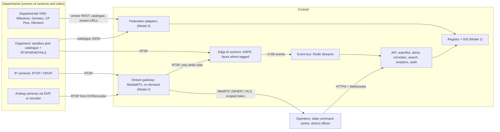
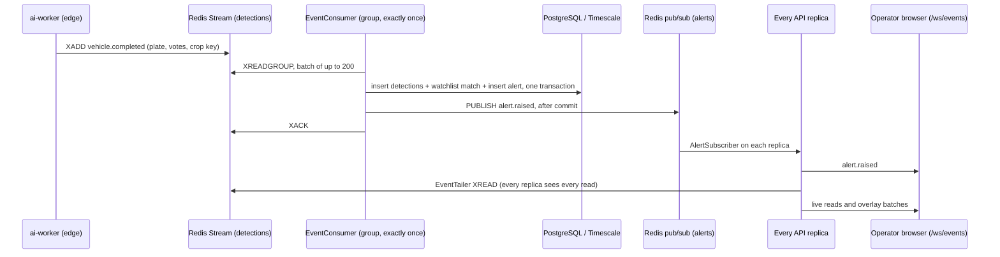
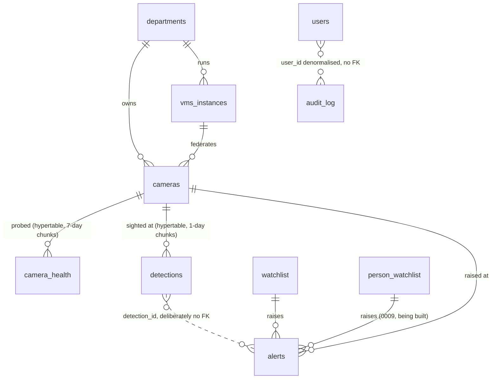
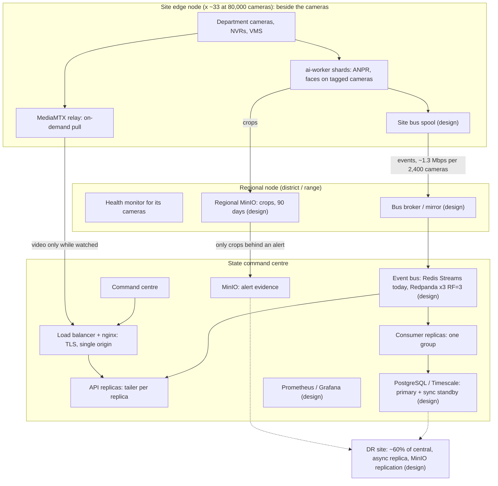

# Contrail — High-Level Design

**Gujarat Police CCTV Hackathon "Sentinel".** Sandbox round 12–13 Oct 2026.

Contrail is a statewide platform that unifies the CCTV Gujarat's departments already
own. It does not replace their cameras or their video management systems (VMS). It
does four things:

- federates the cameras and VMS the departments already run;
- puts every camera on one registry and one map;
- runs analytics next to the cameras;
- sends the centre what the cameras *saw*, not the video itself.

The design follows from one sentence:

> **The central tier carries events, not video.**

**How numbers are labelled in this document**

| Label | Meaning |
|---|---|
| **MEASURED** | Produced by a run, with the source named |
| **ARITHMETIC** | Computed by `scripts/capacity_model.py` or shown inline from stated inputs |
| **EXTRAPOLATED** | Any GPU figure. No GPU has run this code |

**How state is marked**

| Mark | Meaning |
|---|---|
| ✅ | Built and tested |
| 🟡 | Partial |
| 🔧 | Being built (in the working tree, not committed) |
| 📐 | Designed, not built |

Sizing and cost live in [INFRASTRUCTURE.md](INFRASTRUCTURE.md). The requirement map
is in [REQUIREMENTS.md](REQUIREMENTS.md).

---

## 1. The brief, and the answer in one paragraph

**What the brief asks for:**

- a secure, interoperable, cost-effective platform over CCTV from about 26
  departments;
- analog and IP cameras, up to about 1,000 km apart;
- reuse of existing infrastructure;
- growth to about 80,000 cameras without a redesign;
- Model 1 (registry + GIS) is compulsory and must be combined with at least one of
  Models 2, 3 or 4.

**The live test:**

- onboard about 50 mixed cameras from several departments;
- track a vehicle number given on the day, with its full route and a timestamped,
  location-by-location history;
- check live feeds against a watchlist and raise alerts in real time;
- show the GIS, interoperability and end-to-end performance.

**Our answer is a hybrid: Model 1 + Model 3 + selective Model 2, with AI at the edge.**

- **Model 1.** A registry and GIS that knows every camera, its owner, position and
  health.
- **Model 3.** Federation middleware. Departmental VMS stay authoritative for their own
  video.
- **Selective Model 2.** Direct RTSP/ONVIF viewing, pulled on demand, only for the feeds
  someone is watching.
- **Edge analytics.** Next to the video, so that only ~2 KB events cross the WAN.

We reject Model 4 (one central VMS) on bandwidth, storage and ownership grounds
(§2.2).

---

## 2. The architecture choice

### 2.1 The models

| Model | What it means | Our position |
|---|---|---|
| **1 — Registry + GIS** | Know every camera, place it on a map, watch its health | ✅ **Built — compulsory.** The foundation everything else hangs on |
| **2 — Direct viewing + analytics** | Connect to each camera / VMS over RTSP, ONVIF or vendor API | ✅ **Built, selectively.** Streams are pulled through MediaMTX only while someone watches. Analytics run at the edge |
| **3 — VMS federation middleware** | Departmental VMS integrate through API, SDK or metadata exchange | ✅ **Built.** Adapter per protocol or vendor. Catalogues are synced into the registry. VMS stay authoritative |
| **4 — Central VMS with AI** | Replace departmental VMS. Record and analyse everything centrally | ❌ **Rejected.** See §2.2 |

### 2.2 Why not Model 4: the arithmetic

The figures are for 80,000 cameras at 4 Mbps each (1080p15 H.264), from
`python3 scripts/capacity_model.py --cameras 80000` and
[INFRASTRUCTURE §6](INFRASTRUCTURE.md#6-storage). All are **ARITHMETIC**.

| | Model 4: centralise video | Contrail: centralise events |
|---|---|---|
| Sustained bandwidth into the centre | **320 Gbps** | **43.7 Mbps** (2,667 events/s × 2 KB) |
| Ratio | | **7,324× less** |
| Central storage for 7 / 15 days of video | **24.2 PB / 51.8 PB** | **0.** Video stays in departmental NVRs and VMS under their own retention |
| Software decode of every stream | 80,000 × 0.13–0.17 core ≈ **10,000–14,000 cores at the centre**, before any inference (per-frame decode measured: [INFRASTRUCTURE §2](INFRASTRUCTURE.md#2-cpu-per-camera-docker-against-native-coreml)) | The same decode, done at the edge site where the video already is |
| Existing VMS (Milestone, Genetec, CP Plus, Hikvision) | Replaced: retrain, re-procure, migrate | Kept: one adapter each |
| One department's link fails | Its cameras vanish from the centre | Its cameras are marked unreachable on the map. Its own VMS keeps recording |

**Three points follow from this:**

- **Inference is not the difference.** It costs the same wherever it runs.
- **Moving video is the difference.** Model 4 has to move the video. Contrail moves
  only the conclusions.
- **Disk alone settles it.** At 15-day retention, Model 4's video storage priced at
  the model's bulk rate (₹51.8 crore, ASSUMED unit price) exceeds Contrail's whole
  CPU-only capex (₹39.31 crore).

### 2.3 What "hybrid" buys at the live test

- **Federation onboards cameras.** The organisers' 30-camera grid is onboarded through
  `HostedGridAdapter` from their catalogue: Model 3.
- **Selective viewing shows them.** An operator watching one feed costs one stream.
  The grid's watch quota and our CPU both forbid a video wall, and the design never
  needed one.
- **The registry ties it together.** Model 1 shows all of them on one map, with
  health, owner and gaps.

---

## 3. System context



An analog camera with no DVR or encoder can be **registered and mapped** (Model 1
metadata, status `unknown`). It cannot be viewed or analysed until something exposes
RTSP for it.

---

## 4. Components

The services below run as containers, all pinned and published for both amd64 and
arm64. Compose profiles: `base`, `ai`, `ai-multi`, and the scale overlay
`docker-compose.scale.yml`.

| Component | Container | What it does | State |
|---|---|---|---|
| Registry + GIS | `api` + `postgres` (PostGIS) | Camera CRUD, bulk CSV with row-level errors and dry run, GeoJSON, proximity and district queries, departments and VMS records | ✅ |
| Federation adapters | `api` (`app/adapters/`) | `RtspAdapter` (ffprobe, also the fallback), `OnvifAdapter` (Device and Media SOAP), `VendorVmsAdapter` (one class, field-mapped for Milestone, Genetec, CP Plus and Hikvision vocabularies), `HostedGridAdapter` (the organisers' grid), `SimulatedVmsAdapter` | ✅ HostedGrid and RTSP proven against the live grid. ONVIF and VendorVMS are unit-tested against fixture payloads, never against a live VMS |
| Health monitor | `ingest` (API image, separate container) | Staggered probe sweep → `camera_health` hypertable → status flip → `camera_down` alert, auto-closed on recovery. Gap analysis | ✅ |
| Stream gateway | `mediamtx` | RTSP in → WebRTC (WHEP) / LL-HLS out. Paths registered `sourceOnDemand`, released 60 s after the last reader | ✅ |
| Edge AI worker | `ai-worker` (×1 with `make ai`, ×3 with `make ai-multi`) | Vehicle detect (YOLOv8n @640) → ByteTrack → plate detect (YOLO11n @320) → OCR (PP-OCRv4 via RapidOCR) → multi-frame consensus → event. Faces: YuNet + SFace on tagged cameras 🔧. Torch-free: ONNX Runtime + OpenCV | ✅ / 🔧 |
| Event bus | `redis` | Stream `nagarnetra:events:detections` (capped ~100,000), consumer group, alert pub/sub, token denylist, rate-limit counters, fleet roster, persons gallery | ✅ Redis. Redpanda is a config seam only 📐 |
| Core API | `api` (and `consumer` replicas in the scale profile) | Ingest, watchlist matching, alerts, correlator, anomaly, search, analytics, forecast, reports, audit, `/ws/events` | ✅ |
| Object store | `minio` | Plate crops (uploaded from the edge; only the key rides the bus), plus a separate private bucket for persons media 🔧 | ✅ |
| Search index | `opensearch` | Health-probed only. **Nothing indexes into it.** Plate search is Postgres `pg_trgm` | 🟡 runs, unused |
| Command centre | `web` (nginx + React) | Seven workspaces (§4.1). One origin. CSP and security headers | ✅ |
| Simulator | `simulator` | Replays the recorded demonstration clip as an RTSP camera (`CAM-DEMO-01`). Also a load generator | ✅ |

### 4.1 The operator interface

The workspaces are defined once in `web/src/lib/nav.ts`. A role sees only the
workspaces whose screens it may open.

| Workspace | Screens | Used for |
|---|---|---|
| Command | `/dashboard` | The state at a glance: towns map, open alarms, plates arriving |
| Live | `/anpr` | One camera on stage with plate boxes; the rest in a rail |
| Investigate | `/vehicles`, `/reports/vehicle/:plate` | A plate in, a timestamped route out. CSV and printable report |
| Alarms | `/alerts`, `/watchlist` | The triage queue and the watchlist |
| Network | `/map`, `/cameras`, `/health` | GIS map with layered filters, the registry and onboarding, fleet health and gaps |
| Insights | `/traffic` | Counts, flow, congestion, forecast; gaps in the data are labelled |
| Admin | `/users`, `/audit` | Accounts, and the audit trail (reading it is itself audited) |

**⌘K** (or Ctrl K, or `/`) works from any screen:

- type a plate and it opens that vehicle's journey;
- type a camera code or place and it opens that camera;
- type a word and it finds the screen.

---

## 5. Data flows

### 5.1 Onboarding: four routes into one registry

| Route | Mechanism | Audit |
|---|---|---|
| One camera | Network → Cameras form → `POST /api/v1/cameras` | ✅ |
| Bulk | `POST /api/v1/cameras/bulk` (CSV). Row-level errors and dry run | ✅ |
| Self-service by a department | An `api_client` account holding only `camera.create` | ✅ |
| Federated sync | `POST /api/v1/vms/{id}/sync`, or `scripts/sync_sandbox.py`. Reads the VMS catalogue and creates or updates cameras | ✅ |

**How federated sync handles messy catalogues**

- **Ownership.** `owner_of()` takes the department from the catalogue if it says so,
  else infers it from words in the camera name, else keeps the operator's choice. The
  camera is tagged `department-source:<…>`, so the provenance stays visible.
- **No location.** The camera is placed at the state centroid and tagged
  `placement:unknown`. It is **never drawn on a map at a guessed position**. Network
  → `?filter=unplaced` lists these cameras.
- **Grid ids are stored, not derived** (`grid-id:` tag). The organisers' ids have
  already changed scheme once.

### 5.2 Video, on demand (selective Model 2)

```
operator opens a camera
  → GET /api/v1/cameras/{id}/stream   (permission stream.view; audit row "camera.view")
  → camera-scoped stream token, 120 s life
  → gateway path registered sourceOnDemand → MediaMTX pulls the camera only now
  → WHEP (WebRTC), falling back to HLS
  → 60 s after the last reader leaves, MediaMTX releases the camera
```

**How credentials stay server-side**

- A camera's credentials reach MediaMTX over the internal network and are redacted
  from every log line. A test greps for an unredacted one.
- The browser never receives a camera URL.
- The organisers' HLS sits behind a portal session, which the API proxies
  (`/api/v1/grid/...`) under the same scoped token.

### 5.3 The vehicle event path



**The two readers are separate classes on purpose.**

- **`EventConsumer`** uses a consumer group. Each entry goes to exactly one member,
  which is correct for persistence.
- **`EventTailer`** uses plain `XREAD`. Every replica sees everything, which is
  correct for a shared operations picture.

The load test found that one class doing both would have split the live feed between
API replicas without any error ([§15](#15-scale-evidence)).

### 5.4 Inside the edge worker

| Step | What happens | Why |
|---|---|---|
| Read | Drop-to-latest, PTS-timed, one decoder thread per stream | A live source cannot be fallen behind. Latency stays bounded and frames are dropped instead |
| Detect + track | YOLOv8n @640, ByteTrack (pure NumPy) | A vehicle first, then its plate: vehicle-first detection is far more accurate than a full-frame plate search (cited and measured in [research §3.7, §6.2](research/ANPR_ACCURACY_LATENCY.md)) |
| Plate search | YOLO11n @320, scheduled per vehicle only when its view has materially changed | Plate-detector calls per frame fell from 13.3 to 1.45, and OCR calls from 14.2 to 0.7 (MEASURED, `ai-lab/PERFORMANCE.md`) |
| OCR | PP-OCRv4 recognition (RapidOCR / ONNX Runtime). A bounded text-detection fallback for two-row plates | — |
| Consensus | Per-character voting weighted by OCR confidence × crop quality. Grammar repair capped at 2 characters | A recogniser handed a bad crop returns a *confident wrong* answer, not an error |
| Emit | One `vehicle.completed` per vehicle, with `frames_agreeing/frames_total`, runners-up, `grammar_valid`, the crop's object key, and direction of travel | An operator can see why a reading was believed, and overrule it |

**How the edge holds up under load**

- **Thread budget.** `ailab.runtime` divides one process-wide ONNX thread budget
  across cameras ([PERFORMANCE.md](PERFORMANCE.md)). This replaced a measured
  866% CPU / 168-thread state.
- **Sharding.** Workers own a stable hash shard of the camera list (`blake2b mod N`,
  `ai_worker/discovery.py`), with no coordinator.
- **Rotation.** Analysis rotates through the open streams. Coverage becomes partial
  *in time*, and the worker says so ("analysing N of M camera(s)"). It is never
  partial *in space* and silent.
- **Focus.** The camera on an operator's screen is analysed first
  (`POST /cameras/{id}/focus`).
- **Back-off.** A refused grid login pauses the whole host, 120 s doubling to 15 min,
  so the platform cannot lock its own account out (`ai_worker/backoff.py`).

---

## 6. Database structure

PostgreSQL 16 with PostGIS and TimescaleDB, in one image
(`timescale/timescaledb-ha:pg16.14-ts2.29.2-all`). The schema is entirely Alembic
migrations, `0001`–`0009`, under `services/api/alembic/versions/`.

- **Extensions.** `postgis`, `timescaledb`, `pg_trgm`, `pgcrypto` and `btree_gist`
  are asserted at migration time and again at first boot.
- **Enums.** They are stored as strings and checked by the application.



| Table | Purpose | Key structure | Migration |
|---|---|---|---|
| `departments` | Camera-owning departments | `code` unique. Six are seeded: POLICE, HEALTH, GSRTC, PANCHAYAT, MUNICIPAL, SCRB | 0001 |
| `vms_instances` | Federated VMS | `vendor`, `adapter_type`, `base_url`, **`credentials_ref` — a pointer (`vault://`, `env://`, `file://`, `enc://`), never a secret** | 0001 |
| `cameras` | The registry | `camera_code` unique. **`location geography(Point,4326)`**, GiST-indexed, distances in metres. `department_id`, `vms_id`, `district/city/junction`, `heading_deg`, `stream_url`, `sub_stream_url`, `protocol`, `anpr_enabled`, `status`, `tags[]`, `corridor`, `source_file`. Expression index on `upper(camera_code)` | 0001, 0003, 0004, 0008 |
| `camera_health` | Probe history | PK (`camera_id`, `ts`). `reachable`, `fps_actual`, `latency_ms`, `bitrate_kbps`, `frame_drop_pct`, `error_code`. **Hypertable, 7-day chunks** | 0001 |
| `detections` | One row per vehicle **track** (not per frame) | PK (`id`, `ts`). `plate_text` (raw) / `plate_normalised` (lookups), `plate_confidence`, `ocr_raw` JSONB (votes), `is_validated` (grammar), `bbox`, `crop_key`, `direction`, `dwell_s`, `motion_px`, `appearance_embedding` JSONB (no producer yet). **Hypertable, 1-day chunks.** GIN trigram index on `plate_normalised` | 0001, 0006, 0007 |
| `watchlist` | Vehicles of interest | `plate_normalised`, `category`, `priority`, `case_ref`, `remarks`, `valid_from/valid_to`, `active`. Unique (`plate`, `case_ref`). Partial index on active rows | 0001 |
| `alerts` | Raised alerts and their handling | `alert_type`, `priority`, `status`, `plate_normalised`, `confidence`, `notes`, **`reasons` JSONB** (`[{factor, detail}]`). `detection_id`/`detection_ts` without an FK, so an alert outlives its evidence. `person_id`, `similarity`, `face_crop_key` 🔧 | 0001, 0005, 0009 |
| `vehicle_tracks` | Reconstructed journeys | `plate_normalised`, `first_seen/last_seen`, `camera_count`, `hop_count`, **`path geography(LineString)`** (GiST), `hops` JSONB (flagged legs kept), `is_plausible` | 0001 |
| `users` | Named accounts | argon2id `password_hash`, `role`, `must_change_password`, `is_active` (deactivated, never deleted once they have acted) | 0001, 0002 |
| `audit_log` | Who did what | `user_id`, `username`, `role` **denormalised, with no FK**, so history survives account changes. `action`, `resource_type/id`, `ip`, `params` (scrubbed), `result` (`success`/`denied`/`error`) | 0001 |
| `person_watchlist` 🔧 | Wanted and missing persons | `case_ref` and `purpose` **NOT NULL**. `valid_until` NOT NULL. `status` `pending_approval → active → retired/rejected`. `embeddings` JSONB (SFace vectors of the enrolled photo only). `photo_key` in a private bucket. CHECK constraints: **approver ≠ enroller**, and **active requires an approver** | 0009 |

**Retention is enforced by deletion, daily** (`app/services/retention.py`):

| Data | Kept | How |
|---|---|---|
| Detections | 365 days | `drop_chunks` |
| Camera health | 90 days | `drop_chunks` |
| Audit | 1,825 days | predicate delete |
| Alerts | never purged | they are the police record |
| Vehicle crops | 90 days **configured, not wired** | — |
| Persons media | 90 days, purged hourly | wired |
| Person entries | retired at `valid_until` | embeddings destroyed |

There are **no Timescale compression or tiering policies** (see §12).

---

## 7. Matching logic

### 7.1 Vehicle watchlist ✅

The matcher is `app/services/watchlist.py`, an in-memory `WatchlistIndex`. It runs
inside the consumer's batch transaction, on every settled `vehicle.completed`.

| Rule | Detail |
|---|---|
| Normalisation | Entries are upper-cased and reduced to letters and digits (minimum 4). Reads arrive normalised from the edge |
| **Exact match** | Always wins → `watchlist_hit` **at the entry's own priority** |
| **Near match** | Edit distance ≤ 1 (one substitution, insertion or deletion) → `possible_match`. **Capped at medium priority** however severe the entry, with the note "1 character different — verify before acting" |
| Cost | A one-deletion variant index, so a lookup costs about the plate's length, not the watchlist's size |
| Ties | Highest-priority entry wins |
| Validity | `valid_from`/`valid_to` are checked against the **detection's** timestamp, not the clock. An expired BOLO raises nothing |
| Refresh | Index reloaded every 60 s, and at once in the API process on any watchlist change |
| Dedup | 90 s per (kind, plate, camera). The same plate at a *different* camera is a new alert, by design: that is the vehicle moving |
| Categories | `stolen`, `wanted`, `suspect`, `bolo`, `blacklisted`, `echallan`, `expired`, `vip`, `test`. Each entry carries a `case_ref`, which travels into the alert |

**Representative data.** `data/seed/watchlist.csv` holds ten fictional vehicles
(stolen ×4, wanted ×2, blacklisted, suspect, echallan, expired), all with `DEMO/…`
case references. Every plate is at least 3 edits from all 1,516 plates read so far,
so a demo entry cannot be hit by accident.

**MEASURED at the gate** (`docs/BUILD_STATE.md` Phase 6):

| Injected | Result |
|---|---|
| `GJ03AB1234` | `watchlist_hit`, **critical**, on a connected WebSocket in **24 ms** |
| `GJ03AB1284` (one off) | `possible_match`, **medium** |
| An unlisted plate | Nothing |
| An expired BOLO | Nothing |

**Honest limits**

- **Grammar validity is not a match gate.** Any non-empty settled plate is matched.
  `is_validated` is stored and shown. The safeguard is the medium cap on near
  matches, plus the human triage step.
- **The runner-up readings are not matched.** The worker publishes them and the API
  stores them in `ocr_raw`.
- **Deduplication is per process.** N consumer replicas could each raise the same
  plate-and-camera alert within 90 s. The scale profile needs a Redis-keyed deduper.
- **The read must be right before any of this helps.** On AI-labelled legible grid
  crops, about one committed read in five was wrong as shipped (§15.3).

### 7.2 Persons watchlist: YuNet and SFace (being built)

Face matching is the most privacy-sensitive capability in the platform. It is
designed to be **off by default, narrow, approved, audited, expiring, and unable to
remember anyone it was not asked to find.**

**State today**

- In the working tree, not committed:
  - backend, migration `0009`, edge worker integration;
  - tests in `services/api/tests/test_persons.py`,
    `services/ai-worker/tests/test_persons_edge.py` and `ai-lab/tests/test_face.py`.
- The operator screen is not finished.
- The human-confirmation step is designed but **not yet enforced** (see the last row
  of the table).

| Safeguard | Design | Where |
|---|---|---|
| Scope | Face analysis runs **only** on cameras tagged `analytics:faces` (only `CAM-DEMO-02` today). It also needs an unexpired gallery to be present. No tag, or no gallery, means no face detection at all | `services/fleet_roster.py`, `ai-lab/ailab/face/stage.py` |
| Models | **YuNet** face detector (`face_detection_yunet_2023mar.onnx`) and **SFace** recogniser (`face_recognition_sface_2021dec.onnx`), both through OpenCV. Edge face stage capped at 2 fps | `ai-lab/ailab/face/models.py` |
| Enrolment | Exactly one face in the photo, ≥80 px. A `case_ref` and a written `purpose` (≥10 characters) are mandatory. Validity defaults to 30 days, **maximum 90**. The entry is created `pending_approval` | `routers/persons.py` |
| **Supervisor approval (four eyes)** | `person.approve` (admin and supervisor). **The enrolling account cannot approve or reject its own entry.** The API refuses and audits the attempt as DENIED. The database refuses again (CHECK `approved_by <> enrolled_by`; `active` requires an approver) | `routers/persons.py`, migration 0009 |
| What reaches the edge | A Redis gallery of **embeddings only**: no names, no photos. It carries a version, a TTL and the match policy. Republished on approve or retire and every 60 s. The worker keeps it only until it expires | `services/persons.py`, `ai_worker/gallery.py` |
| Match rule | Cosine similarity ≥ **0.45** (stricter than SFace's published 0.363). **≥ 2 frames agree.** A margin of ≥ 0.05 over the next-closest entry. Edge faces ≥ 56 px. The stricter of the edge floor and the published policy applies, setting by setting. **The platform re-checks every match server-side** (entry active and unexpired, model id, threshold, frames, margin) | `ailab/face/gallery.py`, `services/persons.py` |
| **No storage of non-matches** | Faces below size are never embedded. Each embedding is deleted right after comparison. A crop is taken only for a frame that passes threshold and margin, and is discarded if the track never confirms. **Nothing is emitted, stored or logged per non-matching face**; only counters move. No table or column exists for non-matches | `ailab/face/matching.py`, `stage.py` |
| Evidence | Face crops and reference photos live in a **private bucket**, never public-readable. Signed URLs last 120 s, and each issuance is audited | `services/person_media.py` |
| Live feed | `person.match` events are **withheld from the live tailer**. Operators see only the resulting alert, with no name or photo in the push | `services/event_tailer.py` |
| Alert | `person_match`, always **high**, never critical. `reasons` carries the similarity against the threshold, frames agreed against required, the margin, and the category. Deduplicated over 300 s | `services/persons.py` |
| Audit | Every list, view, enrol, approve, reject, retire, match view and photo issue writes a named row. Expiry and media purge are audited as system actions | `routers/persons.py` |
| Expiry and erasure | Entries auto-retire at `valid_until`, checked every minute. Reject, retire or expiry **destroys the embeddings**. Media is purged after 90 days | `services/persons.py` |
| **Human confirmation** | `GET /api/v1/persons/matches/{alert_id}` returns the enrolled face and the matched crop side by side, with the fixed notice "A person must compare the two faces before anyone acts". **Designed: acknowledge or dispatch is refused until a confirming comparison is recorded. Not yet enforced:** today the alert uses the generic lifecycle | `schemas/persons.py` |

Facial recognition is a policy decision before it is an engineering one. The
lawful basis, the DPIA and who may authorise an entry are for the state to decide
([SECURITY.md §7](SECURITY.md#7-lawful-use)). The controls above make misuse visible
and attributable. They do not make use lawful.

---

## 8. Alerting mechanism

| Aspect | Design | State |
|---|---|---|
| Producers | Watchlist matcher (consumer); camera health monitor (`ingest`); anomaly scorer (`route_history`, in the monitor daemon); persons matcher 🔧 | ✅ |
| Types | `watchlist_hit`, `possible_match`, `camera_down` (per camera, or per VMS when one gateway fails), `anomaly`, `person_match` 🔧. `speed` and `convoy` exist as enum values with **no producer** | ✅ |
| Priority | Watchlist hit: the entry's priority (default high). Near match: capped at medium. Camera down: high if ANPR-enabled, else medium; a VMS with >25 cameras affected is high. Anomaly: high if any leg is physically impossible, else medium. Person match: always high | ✅ |
| Triage order | `sort=priority`: severity, then exact hits and person matches ahead of near matches, then inferred types (anomaly) last, then newest | ✅ |
| **Explainable reasons** | `alerts.reasons` (JSONB, migration 0005) as `[{factor, detail}]`. Anomaly factors: `impossible_hop`, `rare_transition`, `slow_transition`, `fast_transition`. Person: similarity, frames, margin, category. Watchlist hits explain themselves in `notes` and the live `watchlist{plate, category, case_ref, exact}` block. Their `reasons` is null | ✅ |
| Delivery | Commit → Redis pub/sub `nagarnetra:alerts:fanout` → `AlertSubscriber` on **every** API replica → `/ws/events`. Slow sockets are dropped, not allowed to block the room. The browser reconnects with 1–30 s back-off. The Alarms screen also polls every 30 s | ✅ |
| Lifecycle | `new → acknowledged → dispatched → closed`, or `false_positive` from any open state. **Each transition is a separate permission**: operators acknowledge; supervisors dispatch and close. Illegal moves → 409. Every transition is audited. False positive needs a reason | ✅ |
| Self-healing | A `camera_down` alert is closed automatically when its camera answers again. That is noted, with the time, in IST | ✅ |
| Known gaps | `camera_down` reaches screens by the 30 s poll, not the push. There is no SSE fallback. A consumer that crashes leaves its pending entries unclaimed (no `XAUTOCLAIM`) | 🟡 |

**MEASURED:**

- injected watchlist plate → alert on a connected WebSocket in **24 ms** (budget 2 s);
- killed stream → camera offline and alert raised in **19 s** (budget 30 s);
- 397 watchlist alerts were raised correctly during the 80,000-camera load test.

---

## 9. Cross-camera tracking and trajectory anomalies

This answers the live test's central ask: *track this plate across cameras.*

`GET /api/v1/vehicles/{plate}/route?since=&until=&format=json|geojson`
(`app/services/correlator.py`). It requires `search.execute` and is audited with the
plate and the window. Also available as CSV (`/api/v1/reports/vehicle/{plate}.csv`)
and as a printable report.

**How the route is built**

1. **Gather sightings.** Exact `plate_normalised` sightings, in time order.
2. **Set aside cameras without a position.** Those tagged `placement:unknown` are
   listed separately as *unplaced*, never drawn.
3. **Group into hops.** Consecutive sightings at one camera within 5 min become one
   *hop*, keeping the best-confidence read. A later return is a new hop.
4. **Measure legs.** Each leg is a great-circle distance between cameras, so it is a
   **lower bound** on road distance and labelled as one. Elapsed time runs from
   leaving one hop to arriving at the next.

**Every leg is kept, and flagged rather than dropped:**

- `implausible_speed` (>150 km/h);
- `impossible_simultaneous`;
- `unobserved_gap` (>1 h);
- `co_located` (<50 m);
- `revisit`;
- `heading_conflict` (camera heading against travel bearing >100°).

Route confidence is the weakest hop, minus 0.25 per impossible leg.

**Trajectory anomalies** (`app/services/anomaly.py`, scored every ~2 min on journeys
that advanced):

| Reason | Fires when |
|---|---|
| `impossible_hop` | The leg is physically implausible. This replaces any other reason on that leg |
| `rare_transition` | Fewer than 3 distinct vehicles made this camera-to-camera transition in 30 days, and only once ≥30 vehicles have history |
| `slow_transition` / `fast_transition` | ≥2× or ≤0.5× the median time, with ≥5 timed samples |

**Recorded footage is excluded.** Sightings from cameras tagged `recorded-footage` are
removed from both the journey and the baselines before scoring, so a replayed clip
cannot manufacture a verdict.

**The language is deliberate.** The system reports a **trajectory anomaly**, never a
"suspicious" vehicle. A human decides what movement means.

---

## 10. Deployment tiers



| Tier | Placement | Runs | Sized by (ARITHMETIC, CPU-only, [INFRASTRUCTURE §3](INFRASTRUCTURE.md#3-fleet-sizing-cpu-only)) |
|---|---|---|---|
| **Site edge** | Wherever the video already lands: a district police HQ, a city ICCC, a department's server room | ai-worker shards, MediaMTX relay, site spool | ~27 × 40-core nodes per 2,400 ANPR cameras. 911 statewide |
| **Regional** | District / range | Health monitor, regional crop store, bus broker or mirror | Storage-bound: the warm tier is ~361 TB statewide, split by region |
| **State command centre** | One | API and consumer replicas, DB cluster, bus cluster, search, monitoring, web | 3 DB + 6 service nodes. Two ingest stacks for headroom |
| **DR** | Second site | Standby of the central tier only. The edge is already distributed | 60% of central |

**The same images run at every tier;** only configuration changes. The laptop demo is
this topology collapsed onto one machine, which is what makes the architecture
reviewable and the demo possible from the same code.

---

## 11. Low-bandwidth mode

Contrail is low-bandwidth by construction. What crosses the WAN, and when:

| Flow | Default | Status |
|---|---|---|
| Events (~2 KB per vehicle) | Always, ~1.3 Mbps per 2,400 cameras | ✅ |
| Video | **Only while an operator watches.** Released 60 s after the last reader | ✅ `sourceOnDemand` |
| Health probes | Against the **sub-stream** where the registry has one | ✅ `RtspAdapter.probe_health` |
| Sub-stream for viewing | A "low bandwidth" player toggle that registers `sub_stream_url` (typically ≤1 Mbps) instead of the main stream | 📐 The column exists and VMS adapters fill it. `gateway.py` always pulls `stream_url` |
| Plate crops | Stay regional. Only crops behind an alert go to the centre; the rest are fetched when opened | 📐 One MinIO today. ~328 Mbps statewide if centralised (ARITHMETIC) |
| Live overlay batches | Published only for cameras on someone's screen (the focus heartbeat already knows which) | 📐 Published for every analysed camera today: 9.7 KB/s each (MEASURED) |
| Link outage | Site spool, forwarded on reconnect | 📐 The worker publishes straight to the central stream. Failures are counted and the events are lost |

---

## 12. Storage tiers against retention

**Contrail stores no video.** Each department's VMS keeps its recordings under its
own retention: the brief's 7–15+ days. Contrail keeps evidence and metadata.

| Tier | Holds | Retention | Medium | State |
|---|---|---|---|---|
| Hot | Detections, alerts, health, audit | 7–15 days (statewide: 3.3 TB at 7 d, 7.1 TB at 15 d) | NVMe, Timescale hypertable | ✅ One Postgres; 1-day chunks |
| Warm | Detections plus plate crops | 90 days (~361 TB statewide, ~320 TB of it crops) | HDD / regional MinIO | 🟡 Crops in one MinIO. **The crop expiry is configured, not wired** |
| Cold | Detections and audit | 1–5 years (~861 TB of detections over 5 y) | Compressed hypertable / object storage | 📐 No compression or tiering policy. Detections are dropped at 365 d |
| Evidence | Crops behind alerts; persons media in a private bucket | Alerts kept; persons media 90 d | Central MinIO | ✅ / 🔧 |

The biggest lever is to keep crops only for alerts and low-confidence reads. That
cuts the warm tier by an order of magnitude.

---

## 13. High availability and disaster recovery

| Layer | Today | Design for production |
|---|---|---|
| API | Stateless. N replicas are correct because the tailer and consumer are split. Proven with compose replicas | Replicas behind HAProxy/nginx, health-checked on `/ready` |
| Ingest | Consumer group with N replicas (`docker-compose.scale.yml`, 3) | ≥2 stacks at statewide rate, plus `XAUTOCLAIM` for crashed consumers |
| Bus | Single Redis, AOF, `noeviction`, stream capped at 100,000 | **Redpanda, 3 brokers, RF=3.** The settings seam exists (`event_bus_backend`); **no Kafka client is written** |
| Database | Single instance | Patroni: primary plus synchronous standby in the centre, async replica at DR, WAL archived to object storage (pgBackRest or WAL-G) |
| Objects | Single MinIO | Erasure-coded per site, and site replication of the evidence bucket to the centre and DR |
| Edge | A site failure loses that site's analytics only, and shows on the map | Site spool (§11). Workers are stateless and re-shard on restart |
| Targets | **None claimed.** No backup exists, so no restore has been timed | RPO 15 min, RTO 1 h. **Proven only by a timed restore drill** (rollout gate, §17) |

---

## 14. Monitoring

**What exists ✅**

- `GET /health` (liveness).
- `GET /ready`: Postgres and Redis are critical; OpenSearch, MinIO and MediaMTX make
  it `degraded`.
- `GET /metrics`: JSON. Ingest and worker-fleet rates, worker p50/p95/p99 latency,
  failures, tailer, alert fan-out and socket counts.
- Every worker logs its coverage, and posts its stats to Redis.

**What does not exist ❌**

- Prometheus exposition. `prometheus-client` is pinned but never imported.
- Prometheus and Grafana themselves. `make scale` names them, but no compose file
  contains them.

**The design 📐**

- Prometheus scrapes:
  - the API (via a text-format exporter);
  - MediaMTX (`:9998`, already enabled inside the network);
  - node, Postgres and Redis exporters.
- Grafana dashboards show:
  - ingest rate and consumer lag;
  - capture→persisted p95;
  - per-site coverage ("analysing N of M");
  - availability by department;
  - alerts by type.
- Alertmanager pages on:
  - consumer lag;
  - a site going silent;
  - database replication lag.

---

## 15. Scale evidence

### 15.1 Measured

| What | Result | Source |
|---|---|---|
| Central ingest at statewide rate | **2,774 events/s** median (offered 2,664), 80,000 camera identities, 3 consumer replicas, **0 failed**, 388,713 rows, 397 alerts. 150 s run, one laptop | `tests/load/results/load-20260905T064430.json` |
| Latency at that rate | p50 / p95 / p99 capture→persisted **4.8 / 5.7 / 5.9 s**. **Missed the 3 s target.** The backlog grew to 10,237 during the run and cleared after the generator stopped: queue wait, not processing | same |
| Capture → browser, recorded camera | p50 **135 ms**, p90 201 ms, p99 345 ms. Bus + API + socket < 5 ms of it | `docs/PROGRESS.md`, 13 Sep |
| Inference cost per analysed 1080p frame | Docker 0.30–0.80 core-s. Native CoreML 0.096–0.107 | [research §2.4](research/ANPR_ACCURACY_LATENCY.md) |
| Live laptop | 31 grid streams open, all analysed: ~10 cores. 4 always-on plus the focus camera: 4.4–5.6 cores, 2.1–2.8 grid plates/min at night | `docs/BUILD_STATE.md`, 11 Oct |

### 15.2 What the load test found that 443 tests had not

- **`upper(camera_code)` defeated the index.**
  - At 80,000 cameras each lookup cost 106 ms, scanning 80,278 rows, and ingest fell
    to 140 events/s.
  - Migration `0003` added an expression index, and throughput recovered 7.5×.
- **One consumer class doing both persistence and fan-out** would have shown each of
  two API replicas half the state's traffic, with no error anywhere. This is now split
  (§5.3).
- **Unknown camera codes were cached forever.** A camera onboarded while the platform
  ran would have been stored unattributed. Negative lookups now expire after 60 s.

### 15.3 ANPR accuracy, stated plainly

The research of 12 Oct used 60 legible grid crops labelled by an AI, not by two
humans, so the confidence interval is about ±10–12 points. Exact match:

- **61.7% as shipped**;
- **83.3%** with raw crops fed to the recogniser (McNemar p = 0.001);
- of the reads the platform committed as grammar-valid, **78% were exact** as shipped.

Live plate yield on the grid at night:

| Vehicle class | Completed vehicles with a grammar-valid plate |
|---|---|
| Cars | 11.3% |
| Trucks | 19.7% |
| Buses | 14.8% |
| Two-wheelers | 0% |

**We claim no accuracy figure for the system.** Claiming >90% would need a two-person,
human-labelled set of about 400 vehicles scoring ≥93%
([research §7](research/ANPR_ACCURACY_LATENCY.md)).

### 15.4 Sizing (ARITHMETIC)

Sizing is computed, not tabulated. At 0.46 core per camera (CPU):

| Fleet | Edge compute | Capex | Opex / year |
|---|---|---|---|
| 80,000 cameras | ~36,000 cores, 911 nodes | ₹39.31 crore | ₹8.78 crore |

GPU scenarios are **EXTRAPOLATED**:

- 91–228 nodes, ₹9.7–19.9 crore capex;
- they also need hardware decode, which is not built.

Full derivation: [INFRASTRUCTURE.md](INFRASTRUCTURE.md).

---

## 16. Security

The summary is below. The full model, including what is not implemented, is in
[SECURITY.md](SECURITY.md).

| Control | Implementation |
|---|---|
| Identity | No self-registration. Named accounts only. argon2id. Password policy (length, not a published credential, no username, no runs). Forced change of admin-set passwords |
| Tokens | JWT access 15 min, refresh 7 days with rotation and a denylist checked on HTTP **and** on the WebSocket handshake. Issuer and audience asserted |
| Authorisation | Six roles (admin, supervisor, operator, analyst, auditor, api_client) in one server-side matrix (`app/core/rbac.py`). Alert transitions are separate grants. **An auditor cannot run a vehicle search** |
| Audit | Every mutation, every plate search, every stream open and every watchlist change writes an `audit_log` row with user, role, IP, parameters and result. **Denied attempts are recorded. Reading the audit log is itself audited.** Tested |
| Streams | Separate token type, ~2 min, scoped to one camera. Camera credentials never reach a browser and are redacted in every log |
| Rate limits | Redis fixed window, so per deployment rather than per replica: 300 / 60 s general, **10 failures / 300 s** on auth. Fails open. Health paths exempt |
| Secrets | `.env` gitignored. No in-code secret defaults. `credentials_ref` is a pointer. `enc://` values sealed with AES-256-GCM (key ring, mandatory associated data, 44 tests) |
| Browser | One origin. CSP, frame, type and referrer headers (asserted by `tests/e2e/test_web_headers.py`). Tokens in `sessionStorage` |
| Lawful use | A `case_ref` on every watchlist entry. Near matches labelled and capped. Retention enforced by deletion. Persons safeguards (§7.2) |
| **Not implemented** | **TLS** (`deploy/nginx` is plain HTTP). Volume and object encryption at rest. Backups. Penetration test. AGPL-3.0 weights on the detectors |

---

## 17. Rollout plan

Each stage starts only when the previous stage's gates have **printed** their
numbers. A gate that has not been run is a gate that has not passed.

| Stage | Scope | Gates (all measured, none asserted) |
|---|---|---|
| **0 — Sandbox** (now) | One laptop. The organisers' 30-camera grid plus a recorded ANPR feed | ✅ Grid onboarded through federation. ✅ Watchlist alert in 24 ms. ✅ Route reconstruction with flagged legs. ✅ 2,774 events/s at 80,000 identities, 0 failed. ❌ p95 < 3 s (5.7 s) |
| **1 — One district** | One edge site on server hardware, its departments' VMS federated. Start with that district's ANPR-grade cameras | (a) Re-run the per-frame profile on the **actual x86 node**, and replace the Apple-Silicon constants in `capacity_model.py`. (b) A two-person, human-labelled set of ≥400 vehicles from these cameras, accuracy reported with a Wilson interval. (c) Validate the 0.5 analysed-fps assumption against measured junction transit times. (d) Pull the WAN for 1 h: **zero events lost** (needs the site spool). (e) p95 capture→alert < 3 s at the site's real rate. (f) TLS on, volume encryption on |
| **2 — One range** | Several districts plus the regional node | (a) Regional crop store and bus forwarding live. (b) **Timed restore and failover drill**: kill the DB primary and measure RPO/RTO against 15 min / 1 h. (c) Load test at **2×** the range's measured event rate, with p95 < 3 s. (d) If GPUs are proposed: one GPU node with hardware decode measured against the CPU node on the same cameras, replacing the EXTRAPOLATED rows |
| **3 — The state** | 33 sites, every department onboarded | (a) Central ingest at **2× statewide**, 5,334 events/s, with p95 < 3 s. (b) DR failover rehearsed. (c) Third-party penetration test closed. (d) AGPL detector weights replaced, or the obligation accepted. (e) DPIA and authorisation rules for watchlists, especially persons, signed off by the state |

**What scales without redesign**

- Sites are independent.
- Workers re-shard by hash.
- The event tier scales by adding consumer replicas.

**What must change on the way**

- Redis gives way to Redpanda behind the existing seam.
- A single Postgres becomes a replicated cluster.
- One MinIO becomes regional stores.

Those are deployment changes to the same services, not a new architecture.

---

## 18. What is not built

Stated here so that nobody finds it first.

| Gap | Where it bites |
|---|---|
| Redpanda/Kafka bus driver | Multi-site, multi-node event tier (§13) |
| Site spool / store-and-forward | A WAN outage loses that site's events (§11) |
| Regional crop stores, gated overlay, sub-stream viewing | Statewide WAN budget (§11) |
| Prometheus exposition, Prometheus and Grafana | Operations at scale (§14) |
| Backups, replicas, DR | Any RPO/RTO claim (§13) |
| TLS, encryption at rest | Deployment ([SECURITY §8](SECURITY.md#8-what-is-not-implemented)) |
| Vehicle-crop expiry, Timescale compression and tiering | Storage beyond hot (§12) |
| OpenSearch indexing | Search uses `pg_trgm` only |
| Department management API | ~26 departments need a seed or migration change (6 are seeded) |
| Hardware decode | Any GPU density (INFRASTRUCTURE §2) |
| Human-labelled accuracy set | Any accuracy claim (§15.3) |
| Persons: operator screen, enforced confirmation | §7.2 |
| `speed` / `convoy` alert producers | Enum values only. Convoys are on demand (`GET /vehicles/{plate}/convoy`) |
| Contracts | The event shape is hand-written in `ai-lab/ailab/stream/events.py` and duplicated in the load generator. `packages/contracts/` is empty |

---

## 19. Related documents

- [INFRASTRUCTURE.md](INFRASTRUCTURE.md) — compute, bandwidth, storage, hardware and cost, from `scripts/capacity_model.py`
- [REQUIREMENTS.md](REQUIREMENTS.md) — every Sentinel requirement mapped to code, or to a marked gap
- [SECURITY.md](SECURITY.md) — controls, retention, lawful use, and what is not implemented
- [PERFORMANCE.md](PERFORMANCE.md) — the worker thread budget
- [GPU.md](GPU.md) — why there is no accelerator inside Docker on Apple Silicon
- [research/ANPR_ACCURACY_LATENCY.md](research/ANPR_ACCURACY_LATENCY.md) — where ANPR time and accuracy go, and what to change
- [DEMO_SCRIPT.md](DEMO_SCRIPT.md) and [PANIC.md](PANIC.md) — the live test, and what to do when something breaks
- [API.md](API.md) — every endpoint, generated from the live OpenAPI document
- [BUILD_STATE.md](BUILD_STATE.md) — the build history and the evidence behind each number
