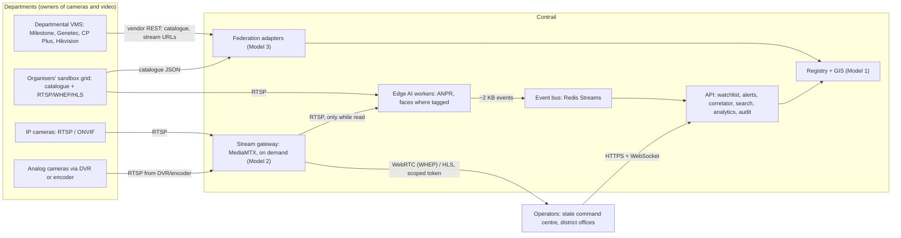
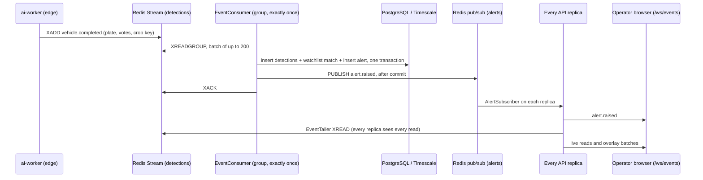
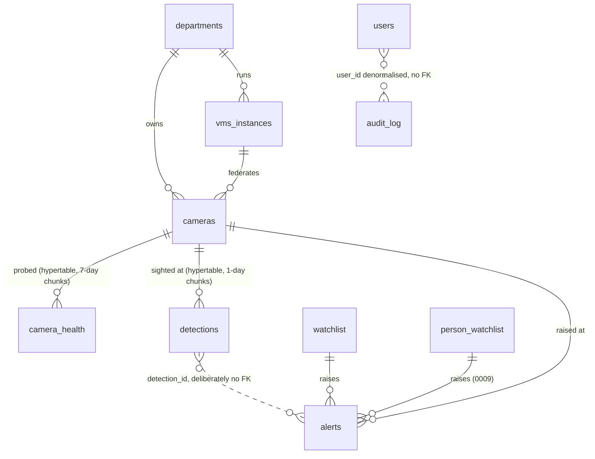
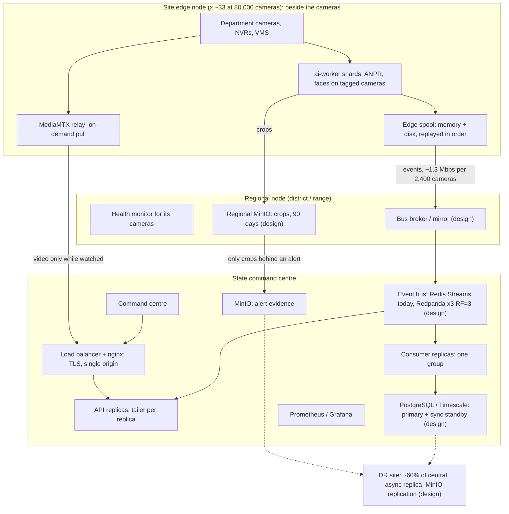
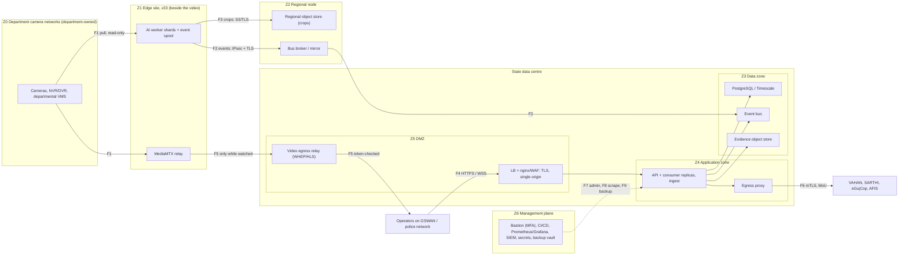

# Contrail — High-Level Design

**Gujarat Police CCTV Hackathon "Sentinel".** Sandbox round 12–13 Oct 2026.

Contrail is a statewide platform that unifies the CCTV Gujarat's departments already
own. It does not replace their cameras or their video management systems (VMS). It
does four things:

- federates the cameras and VMS the departments already run;
- puts every camera on one registry and one map;
- runs analytics next to the cameras;
- sends the centre what the cameras *saw*, not the video itself.

The design follows from one sentence:

> **The central tier carries events, not video.**

**How numbers are labelled in this document**

| Label | Meaning |
|---|---|
| **MEASURED** | Produced by a run, with the source named |
| **ARITHMETIC** | Computed by `scripts/capacity_model.py` or shown inline from stated inputs |
| **ASSUMED** | A declared input: a bitrate, an event rate, a retention or a unit price. Each is a constant in `capacity_model.py` that can be overridden |
| **EXTRAPOLATED** | Any GPU figure. No GPU has run this code |

**How state is marked**

| Mark | Meaning |
|---|---|
| ✅ | Built and tested |
| 🟡 | Partial |
| 🔧 | Being built (in the working tree, not committed) |
| 📐 | Designed, not built |
| ❌ | Not built, or open |

Detailed sizing lives in [INFRASTRUCTURE.md](INFRASTRUCTURE.md). The requirement
map is in [REQUIREMENTS.md](REQUIREMENTS.md).

**Where each part of the brief's HLD is answered**

| The brief asks for | Section |
|---|---|
| Overall architecture | [§2](#2-the-architecture-choice) choice of model, [§3](#3-system-context) context, [§4](#4-components) components |
| Integration strategy | [§5](#5-integration-strategy-and-data-flows) (adapters, onboarding, on-demand video, why departmental systems are unaffected), [§20](#20-department-wise-information-requirements) per department |
| AI and video analytics | [§5.5](#55-ai-and-video-analytics-at-a-glance), [§7](#7-matching-logic) vehicle and persons matching, [§9](#9-cross-camera-tracking-and-trajectory-anomalies) tracking and anomalies, [§15.3](#153-anpr-accuracy-stated-plainly) accuracy |
| Cybersecurity architecture | [§16](#16-cybersecurity-architecture) zones, flows, identity, threat model, prototype against production |
| Deployment architecture | [§10](#10-deployment-tiers) tiers, [§16.2](#162-network-zones-and-segmentation-production-design) zones |
| Sizing: hardware and software | [§15.4](#154-sizing-arithmetic), [INFRASTRUCTURE §3, §7](INFRASTRUCTURE.md#3-fleet-sizing-cpu-only) |
| Sizing: network and bandwidth | [§11](#11-low-bandwidth-mode), [§19.3](#193-what-the-hybrid-avoids), [INFRASTRUCTURE §5](INFRASTRUCTURE.md#5-bandwidth) |
| Sizing: storage and retention | [§6](#6-database-structure) retention, [§12](#12-storage-tiers-against-retention), [INFRASTRUCTURE §6](INFRASTRUCTURE.md#6-storage) |
| Sizing: AI processing capacity | [§15](#15-scale-evidence), [INFRASTRUCTURE §2, §4](INFRASTRUCTURE.md#2-cpu-per-camera-docker-against-native-coreml) |
| Disaster recovery | [§13](#13-high-availability-and-disaster-recovery), with RPO/RTO targets per failure |
| Statewide rollout plan | [§17](#17-rollout-plan) gated stages, [§22](#22-future-roadmap) the work behind each gate |
| Cost-benefit analysis | [§19](#19-cost-benefit-analysis) |
| Department-wise information requirements | [§20](#20-department-wise-information-requirements) |
| Scalability strategy | [§21](#21-scalability-strategy) |
| Future roadmap | [§22](#22-future-roadmap) |

---

## 1. The brief, and the answer in one paragraph

**What the brief asks for:**

- a secure, interoperable, cost-effective platform over CCTV from about 26
  departments;
- analog and IP cameras, up to about 1,000 km apart;
- reuse of existing infrastructure;
- growth to about 80,000 cameras without a redesign;
- Model 1 (registry + GIS) is compulsory and must be combined with at least one of
  Models 2, 3 or 4.

**The live test:**

- onboard about 50 mixed cameras from several departments;
- track a vehicle number given on the day, with its full route and a timestamped,
  location-by-location history;
- check live feeds against a watchlist and raise alerts in real time;
- show the GIS, interoperability and end-to-end performance.

**Our answer is a hybrid: Model 1 + Model 3 + selective Model 2, with AI at the edge.**

- **Model 1.** A registry and GIS that knows every camera, its owner, position and
  health.
- **Model 3.** Federation middleware. Departmental VMS stay authoritative for their own
  video.
- **Selective Model 2.** Direct RTSP/ONVIF viewing, pulled on demand, only for the feeds
  someone is watching.
- **Edge analytics.** Next to the video, so that only ~2 KB events cross the WAN.

We reject Model 4 (one central VMS) on bandwidth, storage and ownership grounds
(§2.2).

---

## 2. The architecture choice

### 2.1 The models

| Model | What it means | Our position |
|---|---|---|
| **1 — Registry + GIS** | Know every camera, place it on a map, watch its health | ✅ **Built — compulsory.** The foundation everything else hangs on |
| **2 — Direct viewing + analytics** | Connect to each camera / VMS over RTSP, ONVIF or vendor API | ✅ **Built, selectively.** Streams are pulled through MediaMTX only while someone watches. Analytics run at the edge |
| **3 — VMS federation middleware** | Departmental VMS integrate through API, SDK or metadata exchange | ✅ **Built.** Adapter per protocol or vendor. Catalogues are synced into the registry. VMS stay authoritative |
| **4 — Central VMS with AI** | Replace departmental VMS. Record and analyse everything centrally | ❌ **Rejected.** See §2.2 |

### 2.2 Why not Model 4: the arithmetic

The figures are for 80,000 cameras at 4 Mbps each (1080p15 H.264), from
`python3 scripts/capacity_model.py --cameras 80000` and
[INFRASTRUCTURE §6](INFRASTRUCTURE.md#6-storage). All are **ARITHMETIC**.

| | Model 4: centralise video | Contrail: centralise events |
|---|---|---|
| Sustained bandwidth into the centre | **320 Gbps** | **43.7 Mbps** (2,667 events/s × 2 KB) |
| Ratio | | **7,324× less** |
| Central storage for 7 / 15 days of video | **24.2 PB / 51.8 PB** | **0.** Video stays in departmental NVRs and VMS under their own retention |
| Software decode of every stream | 80,000 × 0.13–0.17 core ≈ **10,000–14,000 cores at the centre**, before any inference (per-frame decode measured: [INFRASTRUCTURE §2](INFRASTRUCTURE.md#2-cpu-per-camera-docker-against-native-coreml)) | The same decode, done at the edge site where the video already is |
| Existing VMS (Milestone, Genetec, CP Plus, Hikvision) | Replaced: retrain, re-procure, migrate | Kept: one adapter each |
| One department's link fails | Its cameras vanish from the centre | Its cameras are marked unreachable on the map. Its own VMS keeps recording |

**Three points follow from this:**

- **Inference is not the difference.** It costs the same wherever it runs.
- **Moving video is the difference.** Model 4 has to move the video. Contrail moves
  only the conclusions.
- **Disk alone settles it.** At 15-day retention, Model 4's video storage priced at
  the model's bulk rate (₹51.8 crore, ASSUMED unit price) exceeds Contrail's whole
  CPU-only capex (₹39.31 crore).

The full cost-benefit analysis is in [§19](#19-cost-benefit-analysis). It covers the
assumptions, Model 4 priced line by line, sensitivities and the benefits that are
not money.

### 2.3 What "hybrid" buys at the live test

- **Federation onboards cameras.** The organisers' 30-camera grid is onboarded through
  `HostedGridAdapter` from their catalogue: Model 3.
- **Selective viewing shows them.** An operator watching one feed costs one stream.
  The grid's watch quota and our CPU both forbid a video wall, and the design never
  needed one.
- **The registry ties it together.** Model 1 shows all of them on one map, with
  health, owner and gaps.

---

## 3. System context



An analog camera with no DVR or encoder can be **registered and mapped** (Model 1
metadata, status `unknown`). It cannot be viewed or analysed until something exposes
RTSP for it.

---

## 4. Components

The services below run as containers, all pinned and published for both amd64 and
arm64. Compose profiles: `base`, `ai`, `ai-multi`, `monitoring`, and the scale
overlay `docker-compose.scale.yml`.

| Component | Container | What it does | State |
|---|---|---|---|
| Registry + GIS | `api` + `postgres` (PostGIS) | Camera CRUD, bulk CSV with row-level errors and dry run, GeoJSON, proximity and district queries, departments and VMS records | ✅ |
| Federation adapters | `api` (`app/adapters/`) | `RtspAdapter` (ffprobe, also the fallback), `OnvifAdapter` (Device and Media SOAP), `VendorVmsAdapter` (one class, field-mapped for Milestone, Genetec, CP Plus and Hikvision vocabularies), `HostedGridAdapter` (the organisers' grid), `SimulatedVmsAdapter` | ✅ HostedGrid and RTSP proven against the live grid. ONVIF and VendorVMS are unit-tested against fixture payloads, never against a live VMS |
| Health monitor | `ingest` (API image, separate container) | Staggered probe sweep → `camera_health` hypertable → status flip → `camera_down` alert, auto-closed on recovery. Gap analysis | ✅ |
| Stream gateway | `mediamtx` | RTSP in → WebRTC (WHEP) / LL-HLS out. Paths registered `sourceOnDemand`, released 60 s after the last reader | ✅ |
| Edge AI worker | `ai-worker` (×1 with `make ai`, ×3 with `make ai-multi`) | Vehicle detect (YOLOv8n @640) → ByteTrack → plate detect (YOLO11n @320) → OCR (PP-OCRv4 via RapidOCR) → multi-frame consensus → event. Faces: YuNet + SFace, only on cameras tagged `analytics:faces` (§7.2). A bounded store-and-forward spool per worker (§5.4). Torch-free: ONNX Runtime + OpenCV | ✅ |
| Event bus | `redis` | Stream `nagarnetra:events:detections` (capped ~100,000), consumer group, alert pub/sub, token denylist, rate-limit counters, fleet roster, persons gallery | ✅ Redis. Redpanda is a config seam only 📐 |
| Core API | `api` (and `consumer` replicas in the scale profile) | Ingest, watchlist and persons matching, alerts, correlator, candidate sightings, pursuit, anomaly, search, analytics, forecast, reports, audit, `/ws/events` | ✅ |
| External registries | `api` (`app/adapters/registries/`) | VAHAN, SARTHI, eGujCop/CCTNS and AFIS/NAFIS behind one `RegistryAdapter` interface. Today each answers from a **labelled fictional reference dataset** (migration `0010`), stamped `source: reference` with provenance text. A live connector is one class plus one line in `registries_for` | ✅ interface · reference data only |
| Object store | `minio` | Plate crops (uploaded from the edge; only the key rides the bus). Persons media in a separate bucket that is never given a policy. Both buckets private, reached only by presigned links | ✅ |
| Monitoring | `prometheus`, `grafana` (`monitoring` profile) | Scrapes `/metrics/prometheus` and MediaMTX; alert rules with unit tests; one provisioned pipeline dashboard (§14) | ✅ · no paging |
| Search index | `opensearch` | Health-probed only. **Nothing indexes into it.** Plate search is Postgres `pg_trgm` | 🟡 runs, unused |
| Command centre | `web` (nginx + React) | Seven workspaces (§4.1). One origin. CSP and security headers | ✅ |
| Simulator | `simulator` | Replays recorded clips as RTSP cameras: `CAM-DEMO-01` (vehicles; UK plates) and `CAM-DEMO-02` (persons, a stock clip). Both tagged `recorded-footage`. Also a load generator | ✅ |

### 4.1 The operator interface

The workspaces are defined once in `web/src/lib/nav.ts`. A role sees only the
workspaces whose screens it may open.

| Workspace | Screens | Used for |
|---|---|---|
| Command | `/dashboard` | The state at a glance: towns map, open alarms, plates arriving |
| Live | `/anpr` | One camera on stage with plate boxes; the rest in a rail |
| Investigate | `/vehicles`, `/registries`, `/reports/vehicle/:plate` | A plate in, a timestamped route out, with candidate reads and pursuit. Registry lookups (reference data, labelled). CSV and printable report |
| Alarms | `/alerts`, `/watchlist`, `/persons` | The triage queue, the vehicle watchlist, and the persons watchlist with its approval queue |
| Network | `/map`, `/cameras`, `/health` | GIS map with layered filters, the registry and onboarding, fleet health and gaps |
| Insights | `/traffic` | Counts, flow, congestion, forecast; gaps in the data are labelled |
| Admin | `/users`, `/audit` | Accounts, and the audit trail (reading it is itself audited) |

**⌘K** (or Ctrl K, or `/`) works from any screen:

- type a plate and it opens that vehicle's journey;
- type a camera code or place and it opens that camera;
- type a word and it finds the screen.

---

## 5. Integration strategy and data flows

**The strategy in four rules**

1. **Read, never write.** Contrail consumes catalogues, streams and health from
   departmental systems. It never publishes to them, reconfigures them or records
   their video.
2. **One adapter per protocol or vendor.** Each adapter sits behind one
   `CameraAdapter` interface. An unknown vendor degrades to plain RTSP rather than
   vanishing.
3. **Credentials stay server-side.** They are stored as pointers (`credentials_ref`),
   redacted from every log, and never sent to a browser.
4. **The owner stays authoritative.** The registry records where each camera came
   from (`department-source:`, `grid-id:` and `placement:` tags), so provenance is
   always visible.

| Source | What Contrail reads | Adapter | State |
|---|---|---|---|
| IP camera | RTSP stream; ONVIF device and media profiles | `RtspAdapter` (also the fallback), `OnvifAdapter` | RTSP ✅ live. ONVIF ✅ on fixtures, never against a device |
| Departmental VMS (Milestone, Genetec, CP Plus, Hikvision vocabularies) | Catalogue, main and sub-stream URLs, health. Recordings stay in the VMS | `VendorVmsAdapter` | ✅ on fixture payloads, never against a live VMS. `get_recording` exists; no route calls it yet |
| Analog camera | The DVR's or encoder's RTSP. With no encoder: registered and mapped only, status `unknown` | `RtspAdapter`; registry-only | 🟡 no analog-specific adapter |
| The organisers' grid | Catalogue (portal login, one session per address), RTSP into the workers, HLS proxied for viewing | `HostedGridAdapter` | ✅ live, with back-off against its quota |
| Our own recorded feeds | RTSP from the simulator | `SimulatedVmsAdapter` | ✅ |
| National and state registries (VAHAN, SARTHI, eGujCop/CCTNS, AFIS/NAFIS) | Vehicle, licence, case and fingerprint-record lookups, each audited | `RegistryAdapter` subclasses | ✅ interface; answers come from labelled reference data until an MoU gives access |

**Why departmental systems are unaffected**

- **No write path.** No adapter has a method that changes a camera or a VMS. Apart
  from opening and closing a session, the `CameraAdapter` interface
  (`app/adapters/base.py`) has four reads and nothing else: catalogue, stream URL,
  health and recording.
- **Bounded load.**
  - Streams are pulled only while someone watches or a worker analyses them.
  - Health probes prefer the sub-stream.
  - A refused login backs off the whole host: 120 s, doubling to 15 min.
- **Their video, their retention.** Contrail records no video (MediaMTX
  `record: no`). The department's VMS keeps recording whether Contrail is up or down.
- **Their failure stays theirs.** A department or link outage shows as "unreachable"
  on the map. It does not stop any other department.

### 5.1 Onboarding: four routes into one registry

| Route | Mechanism | Audit |
|---|---|---|
| One camera | Network → Cameras form → `POST /api/v1/cameras` | ✅ |
| Bulk | `POST /api/v1/cameras/bulk` (CSV). Row-level errors and dry run | ✅ |
| Self-service by a department | An `api_client` account holding only `camera.create` | ✅ |
| Federated sync | `POST /api/v1/vms/{id}/sync`, or `scripts/sync_sandbox.py`. Reads the VMS catalogue and creates or updates cameras | ✅ |

**How federated sync handles messy catalogues**

- **Ownership.** `owner_of()` takes the department from the catalogue if it says so,
  else infers it from words in the camera name, else keeps the operator's choice. The
  camera is tagged `department-source:<…>`, so the provenance stays visible.
- **No location.** The camera is placed at the state centroid and tagged
  `placement:unknown`. It is **never drawn on a map at a guessed position**. Network
  → `?filter=unplaced` lists these cameras.
- **Grid ids are stored, not derived** (`grid-id:` tag). The organisers' ids have
  already changed scheme once.

### 5.2 Video, on demand (selective Model 2)

```
operator opens a camera
  → GET /api/v1/cameras/{id}/stream   (permission stream.view; audit row "camera.view")
  → camera-scoped stream token, 120 s life
  → gateway path registered sourceOnDemand → MediaMTX pulls the camera only now
  → WHEP (WebRTC), falling back to HLS
  → 60 s after the last reader leaves, MediaMTX releases the camera
```

**How credentials stay server-side**

- A camera's credentials reach MediaMTX over the internal network and are redacted
  from every log line. A test greps for an unredacted one.
- The browser never receives a camera URL.
- The organisers' HLS sits behind a portal session, which the API proxies
  (`/api/v1/grid/...`) under the same scoped token.

### 5.3 The vehicle event path



**The two readers are separate classes on purpose.**

- **`EventConsumer`** uses a consumer group. Each entry goes to exactly one member,
  which is correct for persistence.
- **`EventTailer`** uses plain `XREAD`. Every replica sees everything, which is
  correct for a shared operations picture.

The load test found that one class doing both would have split the live feed between
API replicas without any error ([§15](#15-scale-evidence)).

### 5.4 Inside the edge worker

| Step | What happens | Why |
|---|---|---|
| Read | Drop-to-latest, PTS-timed, one decoder thread per stream | A live source cannot be fallen behind. Latency stays bounded and frames are dropped instead |
| Detect + track | YOLOv8n @640, ByteTrack (pure NumPy) | A vehicle first, then its plate: vehicle-first detection is far more accurate than a full-frame plate search (cited and measured in [research §3.7, §6.2](research/ANPR_ACCURACY_LATENCY.md)) |
| Plate search | YOLO11n @320, scheduled per vehicle only when its view has materially changed | Plate-detector calls per frame fell from 13.3 to 1.45, and OCR calls from 14.2 to 0.7 (MEASURED, `ai-lab/PERFORMANCE.md`) |
| OCR | PP-OCRv4 recognition (RapidOCR / ONNX Runtime) on the **raw** plate crop. A bounded text-detection fallback for two-row plates | CLAHE alone cost about 25 points of exact match on real grid plates. The recogniser resizes the crop itself ([research §3.2](research/ANPR_ACCURACY_LATENCY.md), §5.5) |
| Consensus | Per-character voting weighted by OCR confidence × crop quality. Grammar repair capped at 2 characters | A recogniser handed a bad crop returns a *confident wrong* answer, not an error |
| Emit | One `vehicle.completed` per vehicle, with `frames_agreeing/frames_total`, runners-up, `grammar_valid`, the crop's object key, and direction of travel | An operator can see why a reading was believed, and overrule it |

**How the edge holds up under load**

- **Thread budget.** `ailab.runtime` divides one process-wide ONNX thread budget
  across cameras ([PERFORMANCE.md](PERFORMANCE.md)). This replaced a measured
  866% CPU / 168-thread state.
- **Sharding.** Workers own a stable hash shard of the camera list (`blake2b mod N`,
  `ai_worker/discovery.py`), with no coordinator.
- **Rotation.** Analysis rotates through the open streams. Coverage becomes partial
  *in time*, and the worker says so ("analysing N of M camera(s)"). It is never
  partial *in space* and silent.
- **Focus.** The camera on an operator's screen is analysed first
  (`POST /cameras/{id}/focus`).
- **Back-off.** A refused grid login pauses the whole host, 120 s doubling to 15 min,
  so the platform cannot lock its own account out (`ai_worker/backoff.py`).
- **Store and forward.** Every event goes through a bounded local spool
  (`ai_worker/publisher.py`). `emit` never touches the network; one thread
  publishes, oldest first. When the bus is unreachable, settled sightings
  (`vehicle.completed`, `person.match`) are held — in memory, overflowing to
  segment files on the `ai-worker-spool` volume — and replayed in order when it
  answers. Live boxes and provisional reads are discarded instead: replayed late
  they would draw on video they no longer describe. Past every bound the oldest are
  dropped and counted. Delivery is at least once. MEASURED against a real Redis
  that was paused and then stopped: worst `emit` 1.1 ms during the hung link;
  everything held was replayed in order, and what was held at shutdown was written
  to disk and replayed by the next process.

### 5.5 AI and video analytics at a glance

**Where the work runs.**

- **At the edge:** whatever needs pixels. That is decode, detection, tracking, OCR,
  consensus and face matching.
- **At the centre:** whatever needs the whole state's history. That is watchlist
  matching, cross-camera correlation, anomalies, traffic analytics and the forecast.

| Capability | Runs at | Models (licence) | Output | Evidence | State |
|---|---|---|---|---|---|
| **ANPR** | Edge | YOLOv8n vehicles @640 and YOLO11n plates @320 (**AGPL-3.0 weights**, §16.7 S9); PP-OCRv4 through RapidOCR (Apache-2.0); ByteTrack (NumPy, in-repo) | One `vehicle.completed` per vehicle: plate, votes and runners-up, grammar validity, crop key, direction | §15.3. No system accuracy is claimed | ✅ live |
| **Vehicle counting, flow, congestion, forecast** | Centre, over detections | — | Counts per camera and time bucket; congestion level; a short forecast with its own backtested error | Insights screen; recorded clips dominate today's counts, and their exclusion is 🔧 | ✅ |
| **Cross-camera tracking** | Centre (`correlator.py`, `candidates.py`, `pursuit.py`) | — | Routes with hops, legs and plausibility flags. Candidate reads one or two characters away, each included or dismissed by an analyst and audited. Pursuit pins the next reachable cameras for analysis | Code tested. **No plate has yet been read at two cameras in the live database** (12 Oct) | ✅ code |
| **Trajectory anomaly** | Centre (`anomaly.py`) | — | `anomaly` alerts with `reasons` (impossible hop; rare, slow or fast transition). Recorded footage excluded | §9 | ✅ |
| **Persons watchlist (faces)** | Edge, **only** on cameras tagged `analytics:faces` | YuNet (MIT) and SFace (Apache-2.0) through OpenCV | `person_match` alert, always high and never critical, with both faces side by side for a human to compare | One stock clip of three people: same person 0.581–0.963 cosine, anyone else −0.035–0.286, threshold 0.45; every candidate frame was the enrolled person's (MEASURED, not a validation set) | ✅ with safeguards (§7.2) |
| **Crowd counting** | — | — | — | — | ❌ Not built. Person-class counts from the existing detector are the planned start (§22.3) |

**What the 12 Oct accuracy work changed.** MEASURED; deployed by the 11:02 IST worker
restart. Sources: `ai-lab/FINDINGS.md` §9, `docs/BUILD_STATE.md` "ANPR accuracy and
latency, measured".

| Change | Measured effect |
|---|---|
| OCR reads the raw plate crop (no CLAHE, no padding) | AI-labelled grid crops: gold 42 → **47 of 54**, gold+agreed 50 → **61 of 98** (McNemar p = 0.035). Committed reads right 91% → 92%. OCR CPU 64 → 25 ms per crop |
| Bounded text-detection fallback | 246 → 56 ms per firing |
| Decode every frame, convert only the analysed one | H.264: 0.140 → 0.070 core per open stream. H.265: 0.154 → 0.121 |
| The three together, on the demo clip | Wrong plates 3 → **0**; plates in the labelled set 8 → 10; 0.35 → 0.30 core-s per analysed frame |
| Live, CAM-DEMO-01, before against after (the clip loops identically) | Valid plates in the labelled set 70% → **79%**; outside it 27% → 13%; plates resting on a single read 24% → 9%; median reads per plate 2 → 4; capture→event p50 330 → **241 ms** |

Two further options were measured and **not** switched on:

- **An int8 plate detector.** 24.2 → 8.6 ms per search, but it found only 33 of
  fp32's 35 plates.
- **A native CoreML worker.** 0.30 → 0.10–0.13 core-s per frame, but it misread one
  demo plate on every loop.

---

## 6. Database structure

PostgreSQL 16 with PostGIS and TimescaleDB, in one image
(`timescale/timescaledb-ha:pg16.14-ts2.29.2-all`). The schema is entirely Alembic
migrations, `0001`–`0010`, under `services/api/alembic/versions/`.

- **Extensions.** `postgis`, `timescaledb`, `pg_trgm`, `pgcrypto` and `btree_gist`
  are asserted at migration time and again at first boot.
- **Enums.** They are stored as strings and checked by the application.



| Table | Purpose | Key structure | Migration |
|---|---|---|---|
| `departments` | Camera-owning departments | `code` unique. All 26 of the brief's departments are seeded by `scripts/seed.py`, insert-if-missing (§20). Read-only API today | 0001 |
| `vms_instances` | Federated VMS | `vendor`, `adapter_type`, `base_url`, **`credentials_ref` — a pointer (`vault://`, `env://`, `file://`, `enc://`), never a secret** | 0001 |
| `cameras` | The registry | `camera_code` unique. **`location geography(Point,4326)`**, GiST-indexed, distances in metres. `department_id`, `vms_id`, `district/city/junction`, `heading_deg`, `stream_url`, `sub_stream_url`, `protocol`, `anpr_enabled`, `status`, `tags[]`, `corridor`, `source_file`. Expression index on `upper(camera_code)` | 0001, 0003, 0004, 0008 |
| `camera_health` | Probe history | PK (`camera_id`, `ts`). `reachable`, `fps_actual`, `latency_ms`, `bitrate_kbps`, `frame_drop_pct`, `error_code`. **Hypertable, 7-day chunks** | 0001 |
| `detections` | One row per vehicle **track** (not per frame) | PK (`id`, `ts`). `plate_text` (raw) / `plate_normalised` (lookups), `plate_confidence`, `ocr_raw` JSONB (votes), `is_validated` (grammar), `bbox`, `crop_key`, `direction`, `dwell_s`, `motion_px`, `appearance_embedding` JSONB (no producer yet). **Hypertable, 1-day chunks.** GIN trigram index on `plate_normalised` | 0001, 0006, 0007 |
| `watchlist` | Vehicles of interest | `plate_normalised`, `category`, `priority`, `case_ref`, `remarks`, `valid_from/valid_to`, `active`. Unique (`plate`, `case_ref`). Partial index on active rows | 0001 |
| `alerts` | Raised alerts and their handling | `alert_type`, `priority`, `status`, `plate_normalised`, `confidence`, `notes`, **`reasons` JSONB** (`[{factor, detail}]`). `detection_id`/`detection_ts` without an FK, so an alert outlives its evidence. `person_id`, `similarity`, `face_crop_key` | 0001, 0005, 0009 |
| `vehicle_tracks` | Reconstructed journeys | `plate_normalised`, `first_seen/last_seen`, `camera_count`, `hop_count`, **`path geography(LineString)`** (GiST), `hops` JSONB (flagged legs kept), `is_plausible` | 0001 |
| `users` | Named accounts | argon2id `password_hash`, `role`, `must_change_password`, `is_active` (deactivated, never deleted once they have acted) | 0001, 0002 |
| `audit_log` | Who did what | `user_id`, `username`, `role` **denormalised, with no FK**, so history survives account changes. `action`, `resource_type/id`, `ip`, `params` (scrubbed), `result` (`success`/`denied`/`error`) | 0001 |
| `person_watchlist` | Wanted and missing persons | `case_ref` and `purpose` **NOT NULL**. `valid_until` NOT NULL. `status` `pending_approval → active → retired/rejected`. `embeddings` JSONB (SFace vectors of the enrolled photo only). `photo_key` in a private bucket. CHECK constraints: **approver ≠ enroller**, and **active requires an approver** | 0009 |
| `ref_vahan_vehicles`, `ref_sarthi_licences`, `ref_cctns_firs`, `ref_afis_records` | Reference data behind the registry adapters (§4) | **Labelled fictional rows**, generated deterministically: 330 registrations, 146 licences, 20 FIRs, 9 AFIS records. Every plate is at least 3 edits from all plates read up to 12 Oct. AFIS rows have no field that could hold biometric data | 0010 |

**Retention is enforced by deletion, daily** (`app/services/retention.py`):

| Data | Kept | How |
|---|---|---|
| Detections | 365 days | `drop_chunks` |
| Camera health | 90 days | `drop_chunks` |
| Audit | 1,825 days | predicate delete |
| Alerts | never purged | they are the police record |
| Vehicle crops | 90 days | daily sweep by day partition (`retention.expire_crops`); crops behind an open alert are kept until it closes |
| Persons media | 90 days, purged hourly | wired |
| Person entries | retired at `valid_until` | embeddings destroyed |

There are **no Timescale compression or tiering policies** (see §12).

---

## 7. Matching logic

### 7.1 Vehicle watchlist ✅

The matcher is `app/services/watchlist.py`, an in-memory `WatchlistIndex`. It runs
inside the consumer's batch transaction, on every settled `vehicle.completed`.

| Rule | Detail |
|---|---|
| Normalisation | Entries are upper-cased and reduced to letters and digits (minimum 4). Reads arrive normalised from the edge |
| **Exact match** | Always wins → `watchlist_hit` **at the entry's own priority** |
| **Near match** | Edit distance ≤ 1 (one substitution, insertion or deletion) → `possible_match`. **Capped at medium priority** however severe the entry, with the note "1 character different — verify before acting" |
| Cost | A one-deletion variant index, so a lookup costs about the plate's length, not the watchlist's size |
| Ties | Highest-priority entry wins |
| Validity | `valid_from`/`valid_to` are checked against the **detection's** timestamp, not the clock. An expired BOLO raises nothing |
| Refresh | Index reloaded every 60 s, and at once in the API process on any watchlist change |
| Dedup | 90 s per (kind, plate, camera), **shared by every consumer replica**: a Redis key `nagarnetra:dedup:<kind>:<plate>:<camera>` claimed with `SET NX PX`, released if the alert's transaction rolls back, per-process fallback if Redis is unreachable. The same plate at a *different* camera is a new alert, by design: that is the vehicle moving |
| Categories | `stolen`, `wanted`, `suspect`, `bolo`, `blacklisted`, `echallan`, `expired`, `vip`, `test`. Each entry carries a `case_ref`, which travels into the alert |

**Representative data.** `data/seed/watchlist.csv` holds ten fictional vehicles
(stolen ×4, wanted ×2, blacklisted, suspect, echallan, expired), all with `DEMO/…`
case references. Every plate is at least 3 edits from all 1,516 plates read so far,
so a demo entry cannot be hit by accident.

**MEASURED at the gate** (`docs/BUILD_STATE.md` Phase 6):

| Injected | Result |
|---|---|
| `GJ03AB1234` | `watchlist_hit`, **critical**, on a connected WebSocket in **24 ms** |
| `GJ03AB1284` (one off) | `possible_match`, **medium** |
| An unlisted plate | Nothing |
| An expired BOLO | Nothing |

**Honest limits**

- **Grammar validity is not a match gate.** Any non-empty settled plate is matched.
  `is_validated` is stored and shown. The safeguard is the medium cap on near
  matches, plus the human triage step.
- **The runner-up readings are not matched.** The worker publishes them and the API
  stores them in `ocr_raw`.
- **Deduplication falls back to per process if Redis is down.** Then two replicas
  could each raise the same alert; with Redis up they cannot (tested with two
  consumers racing on one car, `tests/test_alert_dedup_shared.py`). With Redis down
  the consumers cannot read the stream either, so the window is narrow.
- **The read must be right before any of this helps.** On AI-labelled legible grid
  crops, about one committed read in five was wrong as shipped (§15.3).

### 7.2 Persons watchlist: YuNet and SFace

Face matching is the most privacy-sensitive capability in the platform. It is
designed to be **off by default, narrow, approved, audited, expiring, and unable to
remember anyone it was not asked to find.**

**State today**

- ✅ Committed on 12 Oct (`f38573b`):
  - the backend, migration `0009` and the edge stage;
  - the operator screens: `/persons` with its approval queue, and alarms that show
    both faces side by side;
  - tests: `services/api/tests/test_persons.py` (29), `test_persons_edge.py` in the
    worker, and `ai-lab/tests/test_face.py` (41).
- **Verified end to end on `CAM-DEMO-02`.** A stock clip of three people; one
  enrolled by `supervisor` and approved by `admin`. 21 candidate frames, every one
  the enrolled person's and none the other two's. One `person_match` at similarity
  0.73 over 2 frames. Self-approval refused (403, audited). MEASURED (`docs/BUILD_STATE.md`).
- **Not validated on real CCTV faces.** Three people in one well-lit clip is a check
  point, not an error rate. The grid's junction cameras cannot resolve faces at all,
  and are never tagged.
- The human-confirmation step is designed but **not yet enforced** (see the last row
  of the table).

| Safeguard | Design | Where |
|---|---|---|
| Scope | Face analysis runs **only** on cameras tagged `analytics:faces` (only `CAM-DEMO-02` today). It also needs an unexpired gallery to be present. No tag, or no gallery, means no face detection at all | `services/fleet_roster.py`, `ai-lab/ailab/face/stage.py` |
| Models | **YuNet** face detector (`face_detection_yunet_2023mar.onnx`) and **SFace** recogniser (`face_recognition_sface_2021dec.onnx`), both through OpenCV. Edge face stage capped at 2 fps | `ai-lab/ailab/face/models.py` |
| Enrolment | Exactly one face in the photo, ≥80 px. A `case_ref` and a written `purpose` (≥10 characters) are mandatory. Validity defaults to 30 days, **maximum 90**. The entry is created `pending_approval` | `routers/persons.py` |
| **Supervisor approval (four eyes)** | `person.approve` (admin and supervisor). **The enrolling account cannot approve or reject its own entry.** The API refuses and audits the attempt as DENIED. The database refuses again (CHECK `approved_by <> enrolled_by`; `active` requires an approver) | `routers/persons.py`, migration 0009 |
| What reaches the edge | A Redis gallery of **embeddings only**: no names, no photos. It carries a version, a TTL and the match policy. Republished on approve or retire and every 60 s. The worker keeps it only until it expires | `services/persons.py`, `ai_worker/gallery.py` |
| Match rule | Cosine similarity ≥ **0.45** (stricter than SFace's published 0.363). **≥ 2 frames agree.** A margin of ≥ 0.05 over the next-closest entry. Edge faces ≥ 56 px. The stricter of the edge floor and the published policy applies, setting by setting. **The platform re-checks every match server-side** (entry active and unexpired, model id, threshold, frames, margin) | `ailab/face/gallery.py`, `services/persons.py` |
| **No storage of non-matches** | Faces below size are never embedded. Each embedding is deleted right after comparison. A crop is taken only for a frame that passes threshold and margin, and is discarded if the track never confirms. **Nothing is emitted, stored or logged per non-matching face**; only counters move. No table or column exists for non-matches | `ailab/face/matching.py`, `stage.py` |
| Evidence | Face crops and reference photos live in a **private bucket**, never public-readable. Signed URLs last 120 s, and each issuance is audited | `services/person_media.py` |
| Live feed | `person.match` events are **withheld from the live tailer**. Operators see only the resulting alert, with no name or photo in the push | `services/event_tailer.py` |
| Alert | `person_match`, always **high**, never critical. `reasons` carries the similarity against the threshold, frames agreed against required, the margin, and the category. Deduplicated over 300 s | `services/persons.py` |
| Audit | Every list, view, enrol, approve, reject, retire, match view and photo issue writes a named row. Expiry and media purge are audited as system actions | `routers/persons.py` |
| Expiry and erasure | Entries auto-retire at `valid_until`, checked every minute. Reject, retire or expiry **destroys the embeddings**. Media is purged after 90 days | `services/persons.py` |
| **Human confirmation** | `GET /api/v1/persons/matches/{alert_id}` returns the enrolled face and the matched crop side by side, with the fixed notice "A person must compare the two faces before anyone acts". **Designed: acknowledge or dispatch is refused until a confirming comparison is recorded. Not yet enforced:** today the alert uses the generic lifecycle | `schemas/persons.py` |

Facial recognition is a policy decision before it is an engineering one. The
lawful basis, the DPIA and who may authorise an entry are for the state to decide
([SECURITY.md §7](SECURITY.md#7-lawful-use)). The controls above make misuse visible
and attributable. They do not make use lawful.

---

## 8. Alerting mechanism

| Aspect | Design | State |
|---|---|---|
| Producers | Watchlist matcher (consumer); camera health monitor (`ingest`); anomaly scorer (`route_history`, in the monitor daemon); persons matcher (consumer, re-checking the edge's claim) | ✅ |
| Types | `watchlist_hit`, `possible_match`, `camera_down` (per camera, or per VMS when one gateway fails), `anomaly`, `person_match`. `speed` and `convoy` exist as enum values with **no producer** | ✅ |
| Priority | Watchlist hit: the entry's priority (default high). Near match: capped at medium. Camera down: high if ANPR-enabled, else medium; a VMS with >25 cameras affected is high. Anomaly: high if any leg is physically impossible, else medium. Person match: always high | ✅ |
| Triage order | `sort=priority`: severity, then exact hits and person matches ahead of near matches, then inferred types (anomaly) last, then newest | ✅ |
| **Explainable reasons** | `alerts.reasons` (JSONB, migration 0005) as `[{factor, detail}]`. Anomaly factors: `impossible_hop`, `rare_transition`, `slow_transition`, `fast_transition`. Person: similarity, frames, margin, category. Watchlist hits explain themselves in `notes` and the live `watchlist{plate, category, case_ref, exact}` block. Their `reasons` is null | ✅ |
| Delivery | Commit → Redis pub/sub `nagarnetra:alerts:fanout` → `AlertSubscriber` on **every** API replica → `/ws/events`. Slow sockets are dropped, not allowed to block the room. The browser reconnects with 1–30 s back-off. The Alarms screen also polls every 30 s | ✅ |
| Lifecycle | `new → acknowledged → dispatched → closed`, or `false_positive` from any open state. **Each transition is a separate permission**: operators acknowledge; supervisors dispatch and close. Illegal moves → 409. Every transition is audited. False positive needs a reason | ✅ |
| Self-healing | A `camera_down` alert is closed automatically when its camera answers again. That is noted, with the time, in IST | ✅ |
| Known gaps | `camera_down` reaches screens by the 30 s poll, not the push. There is no SSE fallback. A consumer that crashes leaves its pending entries unclaimed (no `XAUTOCLAIM`) | 🟡 |

**MEASURED:**

- injected watchlist plate → alert on a connected WebSocket in **24 ms** (budget 2 s);
- killed stream → camera offline and alert raised in **19 s** (budget 30 s);
- 397 watchlist alerts were raised correctly during the 80,000-camera load test.

---

## 9. Cross-camera tracking and trajectory anomalies

This answers the live test's central ask: *track this plate across cameras.*

`GET /api/v1/vehicles/{plate}/route?since=&until=&format=json|geojson`
(`app/services/correlator.py`). It requires `search.execute` and is audited with the
plate and the window. Also available as CSV (`/api/v1/reports/vehicle/{plate}.csv`)
and as a printable report.

**How the route is built**

1. **Gather sightings.** Exact `plate_normalised` sightings, in time order.
2. **Set aside cameras without a position.** Those tagged `placement:unknown` are
   listed separately as *unplaced*, never drawn.
3. **Group into hops.** Consecutive sightings at one camera within 5 min become one
   *hop*, keeping the best-confidence read. A later return is a new hop.
4. **Measure legs.** Each leg is a great-circle distance between cameras, so it is a
   **lower bound** on road distance and labelled as one. Elapsed time runs from
   leaving one hop to arriving at the next.

**Every leg is kept, and flagged rather than dropped:**

- `implausible_speed` (>150 km/h);
- `impossible_simultaneous`;
- `unobserved_gap` (>1 h);
- `co_located` (<50 m);
- `revisit`;
- `heading_conflict` (camera heading against travel bearing >100°).

Route confidence is the weakest hop, minus 0.25 per impossible leg.

**Trajectory anomalies** (`app/services/anomaly.py`, scored every ~2 min on journeys
that advanced):

| Reason | Fires when |
|---|---|
| `impossible_hop` | The leg is physically implausible. This replaces any other reason on that leg |
| `rare_transition` | Fewer than 3 distinct vehicles made this camera-to-camera transition in 30 days, and only once ≥30 vehicles have history |
| `slow_transition` / `fast_transition` | ≥2× or ≤0.5× the median time, with ≥5 timed samples |

**Recorded footage is excluded.** Sightings from cameras tagged `recorded-footage` are
removed from both the journey and the baselines before scoring, so a replayed clip
cannot manufacture a verdict.

**The language is deliberate.** The system reports a **trajectory anomaly**, never a
"suspicious" vehicle. A human decides what movement means.

---

## 10. Deployment tiers



| Tier | Placement | Runs | Sized by (ARITHMETIC, CPU-only, [INFRASTRUCTURE §3](INFRASTRUCTURE.md#3-fleet-sizing-cpu-only)) |
|---|---|---|---|
| **Site edge** | Wherever the video already lands: a district police HQ, a city ICCC, a department's server room | ai-worker shards (each with its event spool), MediaMTX relay | ~27 × 40-core nodes per 2,400 ANPR cameras. 911 statewide |
| **Regional** | District / range | Health monitor, regional crop store, bus broker or mirror | Storage-bound: the warm tier is ~361 TB statewide, split by region |
| **State command centre** | One | API and consumer replicas, DB cluster, bus cluster, search, monitoring, web | 3 DB + 6 service nodes. Two ingest stacks for headroom |
| **DR** | Second site | Standby of the central tier only. The edge is already distributed | 60% of central |

**The same images run at every tier;** only configuration changes. The laptop demo is
this topology collapsed onto one machine, which is what makes the architecture
reviewable and the demo possible from the same code.

**Orchestration and placement in production (📐, not built).**

- **Orchestration.** The state DC runs the images on Kubernetes (Helm charts).
  Edge sites run k3s, or Compose where a site has a single node.
- **Placement.** Each tier sits in its own network zone, with only the flows of
  §16.2–16.3 allowed between zones.
- **Edge isolation.** No user ever connects to an edge site. The site pulls from
  the cameras and pushes events. Video for someone watching is fetched by the DC's
  video relay, through the site tunnel.
- **Rollout.** The tiers are rolled out district by district under the gates of §17.

---

## 11. Low-bandwidth mode

Contrail is low-bandwidth by construction. What crosses the WAN, and when:

| Flow | Default | Status |
|---|---|---|
| Events (~2 KB per vehicle) | Always, ~1.3 Mbps per 2,400 cameras | ✅ |
| Video | **Only while an operator watches.** Released 60 s after the last reader | ✅ `sourceOnDemand` |
| Health probes | Against the **sub-stream** where the registry has one | ✅ `RtspAdapter.probe_health` |
| Sub-stream for viewing | A "low bandwidth" player toggle that registers `sub_stream_url` (typically ≤1 Mbps) instead of the main stream | 📐 The column exists and VMS adapters fill it. `gateway.py` always pulls `stream_url` |
| Plate crops | Stay regional. Only crops behind an alert go to the centre; the rest are fetched when opened | 📐 One MinIO today. ~328 Mbps statewide if centralised (ARITHMETIC) |
| Live overlay batches | Published only for cameras on someone's screen (the focus heartbeat already knows which) | 📐 Published for every analysed camera today: 9.7 KB/s each (MEASURED) |
| Link outage | Edge spool, forwarded on reconnect | ✅ Bounded spool in each worker (memory, then disk), replayed in order (§5.4). Counters: spooled / replayed / dropped. The 1-hour WAN pull of rollout gate 1(d) is not yet run |

---

## 12. Storage tiers against retention

**Contrail stores no video.** Each department's VMS keeps its recordings under its
own retention: the brief's 7–15+ days. Contrail keeps evidence and metadata.

| Tier | Holds | Retention | Medium | State |
|---|---|---|---|---|
| Hot | Detections, alerts, health, audit | 7–15 days (statewide: 3.3 TB at 7 d, 7.1 TB at 15 d) | NVMe, Timescale hypertable | ✅ One Postgres; 1-day chunks |
| Warm | Detections plus plate crops | 90 days (~361 TB statewide, ~320 TB of it crops) | HDD / regional MinIO | 🟡 Crops in one MinIO, deleted after 90 days by the daily sweep (kept while an open alert points at them) |
| Cold | Detections and audit | 1–5 years (~861 TB of detections over 5 y) | Compressed hypertable / object storage | 📐 No compression or tiering policy. Detections are dropped at 365 d |
| Evidence | Crops behind alerts; persons media in a private bucket | Alerts kept; persons media 90 d | Central MinIO | ✅ |

The biggest lever is to keep crops only for alerts and low-confidence reads. That
cuts the warm tier by an order of magnitude.

---

## 13. High availability and disaster recovery

| Layer | Today | Design for production |
|---|---|---|
| API | Stateless. N replicas are correct because the tailer and consumer are split. Proven with compose replicas | Replicas behind HAProxy/nginx, health-checked on `/ready` |
| Ingest | Consumer group with N replicas (`docker-compose.scale.yml`, 3) | ≥2 stacks at statewide rate, plus `XAUTOCLAIM` for crashed consumers |
| Bus | Single Redis, AOF, `noeviction`, stream capped at 100,000 | **Redpanda, 3 brokers, RF=3.** The settings seam exists (`event_bus_backend`); **no Kafka client is written** |
| Database | Single instance | Patroni: primary plus synchronous standby in the centre, async replica at DR, WAL archived to object storage (pgBackRest or WAL-G) |
| Objects | Single MinIO | Erasure-coded per site, and site replication of the evidence bucket to the centre and DR |
| Edge | A site failure loses that site's analytics only, and shows on the map. A bus outage is held in the worker's spool and replayed (§5.4) | Workers are stateless and re-shard on restart; the spool's disk tier survives a restart |
| Backups | `make backup`: `pg_dump -Fc` + both MinIO buckets, checksummed, then restored into a throwaway Postgres and counted (`make backup-verify`). MEASURED on the demo data: dump 1 s / 10.8 MB, 65,263 objects mirrored in 61 s, restore 3–5 s, every key table's count matched. Not scheduled, not off-site, no WAL archiving ([INFRASTRUCTURE §8.4](INFRASTRUCTURE.md#84-backups)) | WAL archiving to object storage (pgBackRest or WAL-G) for point-in-time recovery |
| Targets | **None claimed.** RPO is "since the last `make backup`" until something runs it on a schedule; the restore into the live stack is guarded and drilled only in parts | RPO 15 min, RTO 1 h. **Proven only by a timed restore drill** (rollout gate, §17) |

### 13.1 Recovery targets by failure

These are **targets for the production design. None is demonstrated.** Each row
names the drill that would prove it. The edge never needs DR of its own, because it
is already spread across 33 sites. Under every failure in this table, the
departments' recorders keep the video.

| Failure | What keeps working | RPO target | RTO target | Mechanism | Proven by |
|---|---|---|---|---|---|
| **One edge worker or node** | Other workers. Its cameras show as unclaimed, never silently missing (`ContrailAiWorkerStale`) | Sightings already on the disk spool: none lost. While it is down no sightings are produced, but the department still has the video | ≤ 15 min: restart or replacement; it reclaims its hash shard on return | Stateless workers ✅; disk spool on a volume ✅; orchestrated restart 📐 | Kill a worker in the pilot and time the return to "analysing N of N" |
| **A site's WAN link** | The site keeps analysing. Each worker spools | **0** within the spool bound. Per worker by default: 20,000 events or 48 MB in memory, then 1 GB on disk ≈ 524,000 events, about 20 days at the model's 0.29 events/s per worker (ARITHMETIC; `ai_worker/config.py`) | Replay on reconnect, in order, at the consumer's batch rate | Edge spool ✅ | Gate 1(d): an hour's pull, zero loss |
| **A bus node** | Producers spool. Consumers resume from their offsets | 0 with RF=3. Today one Redis with AOF | ≤ 5 min (leader election) | Redpanda ×3, RF=3 📐 | Kill a broker during a load test |
| **The database primary, DC intact** | Reads from the standby | **0** (synchronous standby) | ≤ 5 min (Patroni failover) | Patroni 📐 | Gate 2(b): kill the primary |
| **The state DC** | Edge sites keep analysing and spooling. Operators move to DR | **≤ 15 min** (async replica plus archived WAL) | **≤ 1 h** (promote DR, switch DNS) | DR site at 60% of central; MinIO site replication 📐 | Stage 3(b): DR failover rehearsed |
| **Corruption or ransomware** | Nothing on the primary can be trusted | ≤ 15 min by point-in-time recovery. Today: back to the last `make backup` | ≤ 4 h at the statewide hot tier (3.3 TB). Restore throughput is measured only on the 10.8 MB prototype dump | WAL-G or pgBackRest PITR; immutable off-site copies 📐 | A timed restore of a full-size backup |
| **The object store** | Alerts and detections intact; crops unavailable | ≤ 15 min for alert evidence (replication) | ≤ 1 h | Erasure coding and site replication 📐 | Restore drill |

---

## 14. Monitoring

**What exists ✅**

- `GET /health` (liveness) and `GET /ready` (Postgres and Redis critical; OpenSearch,
  MinIO and MediaMTX make it `degraded`).
- `GET /metrics`: JSON, for people and the load test. Unchanged.
- **`GET /metrics/prometheus`**: Prometheus exposition (`app/services/metrics.py`).
  Request rate and latency per route *template* (a plate never becomes a label);
  ingest consumed / persisted / failed and capture→persisted p50/p95/p99 per
  consumer; stream length, consumer lag and pending; alerts raised and open by type
  and priority (from the database); WebSocket clients; seconds since each ANPR
  camera last read a plate, labelled `always_on`; and each edge worker's CPU
  seconds, OS threads, RSS, slots, inference budget, cameras by state and spool
  counters, which the workers publish to the Redis hash `nagarnetra:ai:workers`
  every 5 s. Sources are re-read at most every 5 s; a source that fails is left out
  of the scrape and counted, never served stale.
- **Prometheus and Grafana** behind the `monitoring` compose profile
  (`make monitoring`, loopback-only ports, pinned `prom/prometheus:v3.5.0` and
  `grafana/grafana-oss:12.1.1`). Prometheus scrapes the API and MediaMTX (`:9998`).
  Grafana is provisioned with the "Contrail — pipeline" dashboard: throughput,
  latency, bus, alerts, camera freshness, edge CPU and spool, API, gateway.
- **Alert rules** (`infra/prometheus/rules/contrail.yml`, each with a unit test in
  `infra/prometheus/tests/rules_test.yml`, `promtool test rules` passing): no plate
  read on an always-on camera for 10 min, ingest failures, consumer lag, ingest
  p95 over 3 s, API down, edge worker spooling / dropping / silent, exporter errors.
  MEASURED on 12 Oct: within minutes of being loaded the always-on rule was firing
  for three always-on grid cameras (`SBX-cam10`, `-21`, `-22`), two of which had
  read no plate for about two hours. Whether that is night-time yield or a camera
  not being analysed is what the alert asks a person to find out.

**What does not exist ❌**

- Alertmanager. Rules show in Prometheus `/alerts` and Grafana; nobody is paged.
- Node, Postgres and Redis exporters; availability by department; DB replication lag
  (there is no replica).

---

## 15. Scale evidence

### 15.1 Measured

| What | Result | Source |
|---|---|---|
| Central ingest at statewide rate | **2,774 events/s** median (offered 2,664), 80,000 camera identities, 3 consumer replicas, **0 failed**, 388,713 rows, 397 alerts. 150 s run, one laptop | `tests/load/results/load-20260905T064430.json` |
| Latency at that rate | p50 / p95 / p99 capture→persisted **4.8 / 5.7 / 5.9 s**. **Missed the 3 s target.** The backlog grew to 10,237 during the run and cleared after the generator stopped: queue wait, not processing | same |
| Capture → browser, recorded camera | p50 **135 ms**, p90 201 ms, p99 345 ms. Bus + API + socket < 5 ms of it | `docs/PROGRESS.md`, 13 Sep |
| Capture → event at the edge, recorded camera | p50 **241 ms** after the 12 Oct fixes (330 ms before). Native CoreML worker: p50 25 ms, opt-in and not switched over | `docs/BUILD_STATE.md`, 12 Oct; [GPU.md](GPU.md) |
| Inference cost per analysed 1080p frame | Docker 0.30–0.80 core-s. Native CoreML 0.096–0.107 | [research §2.4](research/ANPR_ACCURACY_LATENCY.md) |
| Live laptop | 31 grid streams open, all analysed: ~10 cores. 4 always-on plus the focus camera: 4.4–5.6 cores, 2.1–2.8 grid plates/min at night | `docs/BUILD_STATE.md`, 11 Oct |

### 15.2 What the load test found that 443 tests had not

- **`upper(camera_code)` defeated the index.**
  - At 80,000 cameras each lookup cost 106 ms, scanning 80,278 rows, and ingest fell
    to 140 events/s.
  - Migration `0003` added an expression index, and throughput recovered 7.5×.
- **One consumer class doing both persistence and fan-out** would have shown each of
  two API replicas half the state's traffic, with no error anywhere. This is now split
  (§5.3).
- **Unknown camera codes were cached forever.** A camera onboarded while the platform
  ran would have been stored unattributed. Negative lookups now expire after 60 s.

### 15.3 ANPR accuracy, stated plainly

There were two evaluations on 12 Oct. Both used night-time grid crops from 11 Oct,
one OCR read per crop, labelled **by AI labellers, not by people**. Both are biased
toward plates the pipeline could partly read. They rank configurations; they do not
certify the system.

| Set | As shipped | Deployed config (raw crop, bounded fallback, junk rule) | Test | Source |
|---|---|---|---|---|
| Research set: 60 confident crops, one labeller, 51 of them from SBX-cam22 | 37/60 = **61.7%** (95% CI 49–73%) | Raw crop alone: 50/60 = **83.3%** (72–91%) | McNemar p = 0.001 | [research §3.2](research/ANPR_ACCURACY_LATENCY.md) |
| Rebuilt in-repo set, **gold**: 54 crops both labellers read alike and were sure of | 42/54 = 77.8% (65–87%) | 47/54 = **87.0%** (76–94%) | +9/−4, p = 0.27 | `ai-lab/FINDINGS.md` §9 |
| Rebuilt set, gold + agreed (n = 98) | 50/98 | **61/98** | +17/−6, p = 0.035 | same |
| Committed (grammar-valid) reads that were right | Research set 76%; rebuilt set 91% | Research set 91%; rebuilt set **92%** | — | same |
| A valid plate claimed on an unreadable crop (the false-alert proxy) | 3 of 31 | 2 of 31 | — | same |

Separately, of the readings the live platform had stored as grammar-valid before
the fixes, **78% were exact** (research §3.1). About one committed grid plate in five
was wrong, and those are the reads a watchlist acts on.

**Live plate yield on the grid at night** (11 Oct, before the fixes):

| Vehicle class | Completed vehicles with a grammar-valid plate |
|---|---|
| Cars | 11.3% |
| Trucks | 19.7% |
| Buses | 14.8% |
| Two-wheelers | 0% |

The grid before/after over equal night windows has not been measured yet. On the
recorded camera, the share of plates resting on a single read fell from 24% to 9%
(§5.5).

**We claim no accuracy figure for the system.** Today's evidence is 83–87% on
*legible* single crops, before the unreadable ones are counted. Against the >90%
bar, that is a miss. A claim would need a two-person, human-labelled set of about 400
vehicles scoring ≥93%, split by day and night, by single- and two-row plates, and
by vehicle class ([research §7](research/ANPR_ACCURACY_LATENCY.md);
[§22.1](#221-days-030-after-the-event-close-the-prototypes-gaps)).

### 15.4 Sizing (ARITHMETIC)

Sizing is computed, not tabulated. At 0.46 core per camera (CPU):

| Fleet | Edge compute | Capex | Opex / year |
|---|---|---|---|
| 80,000 cameras | ~36,000 cores, 911 nodes | ₹39.31 crore | ₹8.78 crore |

GPU scenarios are **EXTRAPOLATED**:

- 91–228 nodes, ₹9.7–19.9 crore capex;
- they also need hardware decode, which is not built.

Full derivation: [INFRASTRUCTURE.md](INFRASTRUCTURE.md). Against a Model 4 build at
the same prices: [§19](#19-cost-benefit-analysis).

---

## 16. Cybersecurity architecture

Contrail traces where private vehicles go and, on tagged cameras, matches faces.
Keeping attackers out is one requirement. **Making misuse by authorised users
visible** is the other.

- §16.1 lists the controls that exist and are tested.
- §16.2–16.6 give the production architecture: zones, the flows that cross them,
  identity, audit, secrets, encryption and the threat model.
- §16.7 sets the laptop prototype against that architecture, gap by gap.

The control-level detail is in [SECURITY.md](SECURITY.md).

### 16.1 Controls in place today

| Control | Implementation |
|---|---|
| Identity | No self-registration. Named accounts only. argon2id. Password policy (length, not a published credential, no username, no runs). Forced change of admin-set passwords |
| Tokens | JWT access 15 min, refresh 7 days with rotation and a denylist checked on HTTP **and** on the WebSocket handshake. Issuer and audience asserted |
| Authorisation | Six roles (admin, supervisor, operator, analyst, auditor, api_client) in one server-side matrix (`app/core/rbac.py`). Alert transitions are separate grants. **An auditor cannot run a vehicle search** |
| Audit | Every mutation, every plate search, every stream open and every watchlist change writes an `audit_log` row with user, role, IP, parameters and result. **Denied attempts are recorded. Reading the audit log is itself audited.** Tested |
| Streams | Separate token type, ~2 min, scoped to one camera. Camera credentials never reach a browser and are redacted in every log |
| Rate limits | Redis fixed window, so per deployment rather than per replica: 300 / 60 s general, **10 failures / 300 s** on auth. Fails open. Health paths exempt |
| Secrets | `.env` gitignored. No secret defaults in application code; `docker-compose.yml` still has development fallbacks (§16.5). `credentials_ref` is a pointer. `enc://` values sealed with AES-256-GCM (key ring, mandatory associated data, 44 tests) |
| Browser | One origin. CSP, frame, type and referrer headers (asserted by `tests/e2e/test_web_headers.py`). Tokens in `sessionStorage` |
| Lawful use | A `case_ref` on every watchlist entry. Near matches labelled and capped. Retention enforced by deletion. Persons safeguards (§7.2) |
| TLS | The web tier also serves HTTPS on :8443 (mounted certificate, or self-signed generated at start), with crops and video proxied under the same origin so an HTTPS page fetches nothing over HTTP. HSTS for real hostnames only. :8080 stays plain HTTP for the demo, and the API on :8000 is plain HTTP ([SECURITY §6](SECURITY.md#6-network-and-browser)) |
| **Not implemented** | TLS on the API's own port and between containers. Volume and object encryption at rest. Off-site, scheduled or point-in-time backups. Penetration test. AGPL-3.0 weights on the detectors. The complete list, with network exposure and demo accounts, is §16.7 |

### 16.2 Network zones and segmentation (production design)

Today everything runs on one Docker network on one laptop (§16.7). The deployment
separates seven zones. Each zone talks only to the zones named below, and **nothing
listens toward a department's camera network**: Contrail always pulls.



| Zone | Contains | Reachable from | May open connections to | Today |
|---|---|---|---|---|
| **Z0** Department camera networks | Cameras, NVRs and DVRs, VMS | The department; the edge zone's fixed addresses only | Nothing in Contrail | The grid over the internet; our clip from the simulator container |
| **Z1** Edge site | AI workers and their spool, MediaMTX relay, health probes | The management plane only. No user ever connects here | Z0 (pull), Z2 or the DC over IPsec, the DMZ relay on request | Same Docker network as everything else |
| **Z2** Regional node | Regional crop store, bus broker or mirror, health monitor | Its region's sites; Z4 | The DC over IPsec | Not built |
| **Z3** Data zone | PostgreSQL/Timescale, event bus, evidence MinIO, OpenSearch | Z4 only, each service with its own database role; Z6 for backups | Nothing. No internet | Every port published on all host interfaces (S2) |
| **Z4** Application zone | API and consumer replicas, ingest monitor, egress proxy | Z5 only | Z3; the external registries through the egress proxy | API published on :8000 (S11) |
| **Z5** DMZ | Load balancer, nginx (TLS, CSP, single origin), video egress relay | Operator networks (GSWAN, police intranet). **Never the public internet** | Z4 | nginx on :8080 (HTTP) and :8443 (HTTPS) |
| **Z6** Management plane | Bastion with MFA, CI/CD, monitoring, SIEM, secret store, backup vault | Named administrators | Every zone, read-only scrape plus administration by SSH certificate | Prometheus and Grafana on 127.0.0.1 only |

### 16.3 Data flows across each boundary

| # | Flow | Crosses | Protection in production | Today |
|---|---|---|---|---|
| F1 | Camera, NVR or VMS → edge worker and relay (RTSP, ONVIF, vendor REST) | Z0 → Z1 | Pull only, from fixed edge addresses allowed by a department-side ACL. A read-only service account per VMS. Credentials resolved at the edge from `credentials_ref` (vault or `enc://`), never stored in the registry. RTSPS where the camera supports it; otherwise RTSP stays inside the department LAN or the IPsec tunnel | Grid RTSP over the internet with credentials, redacted in every log line (tested), stripped from every browser response (tested) |
| F2 | Edge → bus: sightings (~2 KB); persons gallery back to the edge (embeddings only, 15-min TTL) | Z1 → Z2 → Z3 | Site-to-DC IPsec over GSWAN. TLS to the broker. Each site has its own broker identity, allowed only to append to its own stream (Redis ACL or Kafka SASL/mTLS per topic). Per-site HMAC on each event, so a forged event fails at the consumer (📐) | Plain Redis, no password. **Anyone who reaches :6379 can append a fake sighting and raise a real-looking alarm** (S2) |
| F3 | Edge → object store: plate crops; face crops to a separate private bucket | Z1 → Z2 | S3 over TLS. A per-site key that may only write its own prefix | One MinIO. Both buckets private (S1 closed 12 Oct). Presigned links signed with the root user (S7) |
| F4 | Operator browser → platform | Z5 → Z4 | HTTPS only: TLS 1.2/1.3, a CA-issued certificate, HSTS, HTTP redirected. JWT 15 min with a rotating refresh, denylist checked on HTTP and WebSocket. CSP. Rate limits keyed on the peer address the trusted proxy saw | :8443 with a self-signed or mounted certificate; :8080 and the API's :8000 still plain HTTP (S4, S11) |
| F5 | Video to a browser | Z1 → Z5 → operator | Pulled only while watched. WHEP or HLS through the DMZ over TLS. **Every read authorised by the gateway asking the API** (`authMethod: http` → `/api/v1/streams/verify`) against the camera-scoped 120 s token. `camera.view` audited | Grid: proxied under the scoped token ✅. Own MediaMTX paths: readable by anyone who reaches :8888/:8889 (S3) |
| F6 | API → VAHAN, SARTHI, eGujCop, AFIS | Z4 → external | Egress proxy; mTLS or the provider's scheme, under an MoU. Every lookup audited with its case reference. Answers carry `source` and `provenance` | Reference adapters over labelled fictional data, `source: reference` on every answer |
| F7 | Administration | Z6 → all | Bastion with MFA, short-lived SSH certificates, no database access from desks, changes deployed from pinned images by CI/CD | Docker on the laptop |
| F8 | Monitoring | all → Z6 | Scrapes stay inside the zones. `/metrics` and `/metrics/prometheus` are blocked at the ingress. Dashboards behind SSO | Prometheus and Grafana on loopback; `/metrics` unauthenticated and aggregate-only by design |
| F9 | Backups | Z3 → Z6 | Encrypted before they leave the zone; immutable (object lock); off-site; restore drilled | `make backup`, verified by restore, local and unencrypted ([§13](#13-high-availability-and-disaster-recovery)) |

### 16.4 Identity, RBAC and department scope

| | Built and tested ✅ | Production design 📐 |
|---|---|---|
| **People** | Named accounts only; no self-registration. argon2id. A password policy beyond length. Forced change of an admin-set password. Accounts deactivated, never deleted once they have acted | Single sign-on against the state's directory, with **MFA for every human role**. A sealed, audited break-glass admin |
| **Sessions** | JWT access 15 min, refresh 7 days with rotation; revocation checked on HTTP and on the WebSocket handshake. Tokens in `sessionStorage` | Session limits on shared control-room workstations |
| **Roles** | Six roles in one server-side matrix (`app/core/rbac.py`). Alert transitions are separate grants. An auditor cannot search. `api_client` can only create cameras | Unchanged |
| **Four eyes** | Persons enrolment: the enrolling account cannot approve. Enforced by the API and by a database CHECK | Holds only when the two accounts are two people. Today the shared demo password breaks that (S5) |
| **Department scope** | ❌ `users.department_id` exists, and **no query is scoped by it** | Each grant carries `own` or `statewide` ([§20.1](#201-access-classes-design)). Stream tokens for another department's camera are refused unless statewide |
| **Machines** | Stream tokens are a separate type, about 2 min, scoped to one camera | Per-site broker and object-store identities (F2, F3), revocable one site at a time |

### 16.5 Audit, secrets and encryption at rest

**Audit ✅**

- Every mutation, plate search, stream open, watchlist change, persons action and
  registry lookup writes a named `audit_log` row: user, role, IP, scrubbed
  parameters and result.
- Denied attempts are recorded. Reading the audit trail is itself audited.
- Retained 5 years, longer than the data it describes.

Production adds **tamper evidence**: the application role gets INSERT only (UPDATE
and DELETE revoked), each row carries a hash chain, and a daily export goes to WORM
storage and the SIEM. It also adds old→new values on `camera.update`, which today
records field names only.

**Secrets**

- Today: `.env` is gitignored. `credentials_ref` stores a pointer (`vault://`,
  `env://`, `file://`, `enc://`), never a secret. `enc://` values are sealed with
  AES-256-GCM: a key ring, mandatory associated data, 44 tests.
- **The gap:** `docker-compose.yml` falls back to development passwords for
  Postgres, MinIO and the Grafana admin when `.env` does not set them.
- Production: a Vault- or KMS-backed store, read at start. A missing secret fails
  the start instead of falling back. Rotation. Least-privilege identities per
  service:
  - the consumer may insert detections and alerts;
  - reporting reads only;
  - no service holds the MinIO root credential.

**Encryption at rest**

- Today ❌ at the volume and object level. Application-level AES-256-GCM covers
  sealed credentials only.
- Production:
  - LUKS on database and object-store disks;
  - MinIO SSE-KMS per bucket, with its own key for the persons bucket;
  - encrypted backups;
  - keys held in the state data centre's HSM or KMS.

### 16.6 Threat model summary

| Threat | How it would happen here | Production control | State today |
|---|---|---|---|
| **Forged sightings** | Append a fake `vehicle.completed` to the bus and raise a real-looking alarm | Bus reachable only through site tunnels; append-only identity per site; per-site HMAC (📐) | ❌ Redis is open on the network (S2) |
| **Insider tracking a private person** | An officer searches a neighbour's plate | `search.execute` only for class L; every search audited with plate and window; the auditor cannot search; department scope; per-user search-volume review | 🟡 Audit ✅; scope ❌; shared demo passwords make rows unattributable (S5) |
| **Credential theft in transit** | JWTs or passwords read on a shared network | TLS everywhere, HSTS, IPsec on site links | 🟡 TLS only on :8443 (S4) |
| **Camera credential leakage** | An RTSP URL with its password in a log or a browser | Resolved at the edge from a vault; redaction and stripping, both tested | ✅ Redaction and stripping |
| **Unauthorised viewing** | Play a camera without a token | The gateway asks the API about every read | 🟡 Grid ✅; own cameras open (S3) |
| **Evidence or audit tampering** | Someone with database access rewrites history | INSERT-only audit, hash chain, WORM export, object lock on evidence | ❌ Not tamper-evident (S8) |
| **Face data misuse** | A face list used beyond its case | Four eyes; expiry ≤ 90 days; embeddings only at the edge, with a TTL; non-matches never stored; a human confirms; police-only enrolment | ✅ Built. Confirmation before acknowledge or dispatch is designed, not enforced ([§7.2](#72-persons-watchlist-yunet-and-sface)) |
| **Brute force and floods** | Login guessing; request floods | Limits on the peer address seen by a trusted proxy; WAF in the DMZ | 🟡 Limits ✅, but keyed on a caller-supplied `X-Forwarded-For` when :8000 is hit directly (S11) |
| **Compromised edge node** | An attacker owns a site box | Blast radius of one site: append its own events, write its own crop prefix, no database access. The gallery holds embeddings without names or photos, and expires in 15 min | 🟡 Gallery design ✅; per-site identities 📐 |
| **Supply chain** | A poisoned image or model | Pinned image tags and SHA-256-pinned model downloads ✅; CI with type checks ✅; image signing and SBOM 📐 | 🟡 |
| **Ransomware or data loss** | The database is encrypted by an attacker | Immutable off-site backups, point-in-time recovery, drilled restore | 🟡 Manual verified backup, local only |
| **Licence exposure** | AGPL-3.0 detector weights shipped in the deployed artifact | Replace the weights, or accept the obligation (gate 3(d)) | ❌ Open decision (S9) |

### 16.7 Current prototype against production

The S-numbers are the security holes in the 12 Oct review
(`docs/review/SENTINEL_JUDGE_REVIEW.md` §5.2), re-checked against the code on 12 Oct.

| # | Gap | Prototype today | How production closes it |
|---|---|---|---|
| S1 | Plate-crop bucket world-readable | ✅ **Closed** (`b4df4d1`). Private; presigned links 200, unsigned object and bucket listing 403 | Unchanged, plus per-service keys (S7) and object lock on evidence |
| S2 | Internal services on all interfaces; **Redis without a password**; OpenSearch security plugin off | ✅ **Closed** (12 Oct), except the OpenSearch plugin. Only web :8080/:8443 listen beyond the laptop; Postgres, Redis, MinIO, OpenSearch, MediaMTX, the API and the simulator are published on 127.0.0.1 only (refused from the LAN address). Redis requires a password, used by every client (`NOAUTH` without it). OpenSearch has no auth but is reachable only from the bridge and loopback | Zones (§16.2). No published data-zone ports. Redis ACL users and TLS, or Redpanda with SASL/mTLS. OpenSearch security on |
| S3 | **Own simulator streams unauthenticated** | ✅ **Closed** (12 Oct). MediaMTX `authMethod: http` asks the API (`/internal/mediamtx/auth`) about every publish and read: the simulator publishes and the workers read with their own identities; a browser reads only with the camera-scoped, audited stream token, on that camera's path, over WebRTC/HLS. Anonymous RTSP/WHEP/HLS → 401, direct and through :8443 | Unchanged in shape; the gateway's identities from the vault, and the session bound to the operator's client certificate |
| S4 | No TLS | 🟡 HTTPS on :8443 with same-origin proxies for crops and video. :8080, :8000 and container-to-container traffic are cleartext | CA-issued certificate at the DMZ, HTTP redirected, TLS to the bus, database and object store, IPsec on every site link |
| S5 | **Shared demo passwords** for supervisor, operator, analyst and auditor | ✅ **Closed** (12 Oct). Every seeded account, admin and API client included, has its own password generated per install into `.env` (never committed, never printed) and is flagged `must_change_password`; the old shared value is refused for all six. Demo accounts still exist — four eyes holds only if two people hold the two passwords | No demo accounts. Named accounts through SSO and MFA, so four eyes means two people |
| S6 | `ENVIRONMENT=development` in the running stack | ❌ Open (the `.env.example` default) | A production profile: no configuration logging, the API docs gated |
| S7 | Presigned URLs signed with the MinIO root user | ❌ Open. The root password is now generated per install, not the published default, so a URL cannot be forged; the root access key id still appears in every link | A service account with read on the two buckets; the root credential only in the vault |
| S8 | Audit log not tamper-evident | ❌ Open | INSERT-only grant, hash chain, daily WORM export (§16.5) |
| S9 | AGPL-3.0 detector weights | ❌ Open licensing decision for the owner | Retrain in a permissive framework, or accept AGPL (gate 3(d)) |
| S10 | `SECURITY.md` §8 stale | ✅ **Closed** (12 Oct). §8.1 lists what was closed and how it was verified, §8.2 what is open | — |
| S11 | **Rate-limit `X-Forwarded-For` trust** | ✅ **Closed** (12 Oct). Forwarded headers are believed only from the web tier's nginx (`FORWARDED_ALLOW_IPS`, its pinned address); everyone else is the socket peer, and through nginx the right-most unvouched address counts. :8000 is loopback-only. Tested: rotating the header on every failed login still hits 429 | The API reachable only from the DMZ proxy; `--forwarded-allow-ips` set to that proxy; the limiter keyed on the socket peer otherwise |
| — | Development passwords as compose fallbacks | ✅ **Closed** (12 Oct). No fallbacks: an unset secret stops compose. `make env` generates every secret per install; the live stack's JWT key and Postgres, MinIO and Grafana passwords were rotated off the published values | Secrets from the vault only; a missing secret fails the start |
| — | Department-scoped RBAC | ❌ Not built | §20.1 |
| — | Encryption at rest | ❌ Not built | §16.5 |
| — | Backups | 🟡 Manual, verified by restore, local, unencrypted | §13: encrypted, immutable, off-site, point-in-time |
| — | Penetration test | ❌ Not done | Third-party test closed before stage 3 (gate 3(c)) |

**The order of work** was S2 and S11 first — together they let anyone on the same
network raise alarms or reset the login limiter — then S3 and S5; all four are
closed. Open, in order: S7 (per-service credentials), S8 (tamper evidence), S6, S4
beyond the web tier, and S9, before any network other than the laptop's own is
involved.

---

## 17. Rollout plan

Each stage starts only when the previous stage's gates have **printed** their
numbers. A gate that has not been run is a gate that has not passed.

| Stage | Scope | Gates (all measured, none asserted) |
|---|---|---|
| **0 — Sandbox** (now) | One laptop. The organisers' 30-camera grid plus a recorded ANPR feed | ✅ Grid onboarded through federation. ✅ Watchlist alert in 24 ms. ✅ Route reconstruction with flagged legs. ✅ 2,774 events/s at 80,000 identities, 0 failed. ❌ p95 < 3 s (5.7 s) |
| **1 — One district** | One edge site on server hardware, its departments' VMS federated. Start with that district's ANPR-grade cameras | (a) Re-run the per-frame profile on the **actual x86 node**, and replace the Apple-Silicon constants in `capacity_model.py`. (b) A two-person, human-labelled set of ≥400 vehicles from these cameras, accuracy reported with a Wilson interval. (c) Validate the 0.5 analysed-fps assumption against measured junction transit times. (d) Pull the WAN for 1 h: **zero events lost** (the edge spool exists; this pull has not been run). (e) p95 capture→alert < 3 s at the site's real rate. (f) TLS on, volume encryption on |
| **2 — One range** | Several districts plus the regional node | (a) Regional crop store and bus forwarding live. (b) **Timed restore and failover drill**: kill the DB primary and measure RPO/RTO against 15 min / 1 h. (c) Load test at **2×** the range's measured event rate, with p95 < 3 s. (d) If GPUs are proposed: one GPU node with hardware decode measured against the CPU node on the same cameras, replacing the EXTRAPOLATED rows |
| **3 — The state** | 33 sites, every department onboarded | (a) Central ingest at **2× statewide**, 5,334 events/s, with p95 < 3 s. (b) DR failover rehearsed. (c) Third-party penetration test closed. (d) AGPL detector weights replaced, or the obligation accepted. (e) DPIA and authorisation rules for watchlists, especially persons, signed off by the state |

**What scales without redesign**

- Sites are independent.
- Workers re-shard by hash.
- The event tier scales by adding consumer replicas.

**What must change on the way**

- Redis gives way to Redpanda behind the existing seam.
- A single Postgres becomes a replicated cluster.
- One MinIO becomes regional stores.

Those are deployment changes to the same services, not a new architecture. The
work that gets each stage through its gates, and where it starts from today, is in
[§22](#22-future-roadmap). Which departments join first, and what each needs, is in
[§20](#20-department-wise-information-requirements).

---

## 18. What is not built

Stated here so that nobody finds it first.

| Gap | Where it bites |
|---|---|
| Redpanda/Kafka bus driver | Multi-site, multi-node event tier (§13) |
| Regional crop stores, gated overlay, sub-stream viewing | Statewide WAN budget (§11) |
| Alertmanager, node/Postgres/Redis exporters | Nobody is paged; host and database health are not scraped (§14) |
| Scheduled/off-site/PITR backups, replicas, DR | Any RPO/RTO claim (§13). Manual verified backups exist |
| TLS beyond the web tier, encryption at rest | Deployment ([SECURITY §8](SECURITY.md#8-what-is-not-implemented)) |
| Network segmentation; Redis password; stream auth on our own gateway; client-IP trust; demo accounts | Anyone on the same network can inject alarms or watch our own feeds (§16.7, S2, S3, S5, S11) |
| Department-scoped RBAC | Every role sees every department's cameras and alerts (§20.1) |
| Registry metadata for storage, NVR, power, link and maintenance; Excel import; registry export | Model 1 metadata completeness (§20.3) |
| Live VAHAN / SARTHI / eGujCop / AFIS connectors | Reference data only, labelled as such, until an MoU (§4) |
| Crowd counting | The brief's analytics list (§5.5) |
| Timescale compression and tiering | Storage beyond hot (§12) |
| OpenSearch indexing | Search uses `pg_trgm` only |
| Department management API | All 26 are seeded, but adding one needs a seed change (`GET` only) |
| Hardware decode | Any GPU density (INFRASTRUCTURE §2) |
| Human-labelled accuracy set | Any accuracy claim (§15.3) |
| Persons: confirmation enforced before acknowledge or dispatch; validation on real CCTV faces | §7.2 |
| `speed` / `convoy` alert producers | Enum values only. Convoys are on demand (`GET /vehicles/{plate}/convoy`) |
| Contracts | The event shape is hand-written in `ai-lab/ailab/stream/events.py` and duplicated in the load generator. `packages/contracts/` is empty |

---

## 19. Cost-benefit analysis

The comparison is between Contrail's hybrid and a **Model 4 central VMS** for the
brief's ~80,000 cameras. Both are priced with **the same unit prices and the same
analytics pipeline**, so the difference comes from the architecture alone.

**How the figures were made.** Contrail's figures are printed by
`python3 scripts/capacity_model.py --cameras 80000` (and `--gpu-speedup 4`,
`--cameras 16000`). The capacity model has no Model 4 mode, so the Model 4 column is
built from the model's own constants with the arithmetic shown in each row. Every
rupee is **ARITHMETIC from ASSUMED unit prices**: indicative, excluding GST, not
quotes. "Crore" is 10⁷ rupees, "lakh" 10⁵.

### 19.1 Assumptions

| Input | Value | Label | Source |
|---|---|---|---|
| Fleet | 80,000 cameras | brief | — |
| Video per camera | 4 Mbps (H.264 1080p15) | ASSUMED | `capacity_model.py` `video_bitrate_mbps` |
| Video retention | 7–15 days (the brief's "7–15+ days") | brief | Contrail: in departmental recorders. Model 4: at the centre |
| Events | 1 per camera per 30 s, 2,048 B each | ASSUMED (event size MEASURED at 1.8–2.4 KB) | [INFRASTRUCTURE §1](INFRASTRUCTURE.md#1-what-is-actually-measured) |
| Analysis rate | 0.5 analysed frames/s per camera | ASSUMED, the most load-bearing input | `analysed_fps_per_camera` |
| Inference throughput | 4.39 analysed fps per 4-core worker, so 0.46 core per camera | MEASURED (Apple Silicon, Docker; no x86 server measured) | `ai-lab/PERFORMANCE.md` |
| Edge inference node (CPU) | ₹4,00,000 (40 cores, 128 GB) | ASSUMED | `cost_edge_node_cpu` |
| Database node / service node | ₹10,00,000 / ₹4,00,000 | ASSUMED | `cost_db_node`, `cost_service_node` |
| Hot storage / bulk storage | ₹75,000 per TB / ₹10,000 per TB | ASSUMED | `cost_nvme_per_tb`, `cost_bulk_storage_per_tb` |
| WAN | ₹1,50,000 per 100 Mbps site link per year, i.e. **₹1,500 per Mbps-year** | ASSUMED | `cost_uplink_per_site_year` |
| Power and cooling | ₹60,000 per node per year | ASSUMED | `cost_power_per_node_year` |
| Operations staff | ₹12,00,000 per engineer per year, one per 40 nodes | ASSUMED | `cost_ops_engineer_year`, `--ops-ratio` |
| DR | 60% of the **central** tier | ASSUMED | `dr_fraction` |

Excluded from both columns: cameras, NVRs and VMS (they exist), departmental LANs,
data-centre space, GST, and any refresh cycle. The software stack is open source and
no per-camera or per-seat licence fee is priced.

### 19.2 Capex and opex at 80,000 cameras (CPU only)

₹ crore. ARITHMETIC.

| Line | Contrail (hybrid) | Model 4, 7-day video | Model 4, 15-day video | How the Model 4 figure is made |
|---|---|---|---|---|
| Analytics compute: 911 × 40-core nodes | 36.45, at the edge sites | 36.45 | 36.45 | Identical. Inference costs the same wherever it runs |
| Central video storage | **0** | **24.19** (24.19 PB) | **51.84** (51.84 PB) | 80,000 × 4 Mbps = 40 GB/s = 3.456 PB/day; × days × ₹10,000/TB |
| Metadata tier: DB cluster, services, hot/warm/cold event storage | 1.79 | 1.79 | 1.79 | The same events and crops either way |
| DR at 60% of the metadata tier | 1.07 | 1.07 | 1.07 | Same rule as Contrail (see 19.5 for the honest Model 4 DR) |
| **Capex** | **39.31** | **63.50** | **91.15** | |
| Capex relative to Contrail | 1.0× | 1.6× | 2.3× | |
| WAN per year | **0.50** (33 × 100 Mbps site links) | **48.00** | **48.00** | 320 Gbps × ₹1,500 per Mbps-year (= 3,200 × 100 Mbps equivalents) |
| Power and cooling per year (920 nodes) | 5.52 | 5.52 | 5.52 | Storage power not priced: the model has no constant for it |
| Operations staff per year | 2.76 | 2.76 | 2.76 | |
| **Opex per year** | **8.78** | **56.28** | **56.28** | |
| Opex per camera per year | ₹1,097 | ₹7,035 | ₹7,035 | |
| **5-year cost (capex + 5 × opex)** | **83.19** | **344.90** | **372.55** | No refresh, no discounting |

**Lines Model 4 also needs and this table does not price,** because the capacity
model has no constant for them: recording servers that write 40 GB/s, power for
24–52 PB of disk, a data-centre network that takes 320 Gbps in, and re-pointing and
re-licensing 80,000 cameras onto one VMS. Each makes Model 4 dearer, so the Model 4
columns are a **floor**.

**Contrail's own WAN line is generous.** It buys a 100 Mbps link per 2,400-camera
site, against ~1.3 Mbps of events. The rest carries on-demand video: about 20
concurrent main-stream viewers per site ([INFRASTRUCTURE §5.3](INFRASTRUCTURE.md#53-video-on-demand-arithmetic)).

### 19.3 What the hybrid avoids

| Resource | Model 4 | Contrail | Label |
|---|---|---|---|
| Sustained traffic into the state centre | **320 Gbps** of video | **43.7 Mbps** of events: **7,324× less**. Even if every plate crop were also forwarded (~328 Mbps, which the design keeps regional), ~860× less | ARITHMETIC |
| Per 2,400-camera site uplink | 9.6 Gbps | ~1.3 Mbps of events, plus 4 Mbps per operator actually watching | ARITHMETIC |
| Central video storage | 24.19 PB (7 d) / 51.84 PB (15 d) | **None.** Video stays in departmental NVRs and VMS | ARITHMETIC |
| Decode of every stream | At the centre: 80,000 × 0.13–0.17 core ≈ 10,000–14,000 cores before inference | At the edge, inside the same 0.46 core per camera. **The decode moves; it does not disappear** | ARITHMETIC from MEASURED decode |
| A district link fails | Its cameras vanish from the centre, and from the central recording | Shown as unreachable. The department keeps recording. The worker's spool holds settled sightings and replays them ([§5.4](#54-inside-the-edge-worker)) | Built; the 1-hour WAN pull (gate 1(d), [§17](#17-rollout-plan)) is not yet run |

### 19.4 Reuse of departmental investment

- **Cameras, NVRs and VMS are reused, not replaced.** They are excluded from
  Contrail's capex because Contrail never needs them replaced. Each vendor costs one
  adapter class ([§5](#5-integration-strategy-and-data-flows)), not a migration.
- **The recorders already hold the retention the brief asks for.** At the same
  4 Mbps and 7–15 days, the departments' existing recorders already hold the
  equivalent of **24.19–51.84 PB**, which is **₹24.19–51.84 crore** at the model's
  bulk price (ARITHMETIC; the real installed base is a survey result we do not have).
  Contrail uses that storage where it already is. Model 4 buys it a second time at
  the centre, which is its storage line in §19.2, or strands it.
- **Licences, operator training and maintenance contracts stay valid.** Operators
  keep using their own VMS clients for playback. Contrail adds a statewide layer over
  them. These are not priced, again for want of an installed-base survey.

### 19.5 What would change the answer

| Change | Contrail | Model 4 | Effect on the comparison | Label |
|---|---|---|---|---|
| WAN at **one tenth** of the model's per-Mbps price (bulk circuits are cheaper per Mbps) | Opex 8.78 (WAN is already its smallest line) | WAN 4.80/yr; opex 13.08/yr; 5-year 128.90 (7 d) / 156.55 (15 d) | Model 4 is still **1.5–1.9×** over five years | ARITHMETIC |
| **Honest DR for Model 4.** In Model 4 the centre holds all the video and all the analytics, so a DC loss stops everything. The same 60% rule then covers them too | Unchanged: its edge is already spread over 33 sites | +37.46 (7 d) / +54.04 (15 d); capex **99.88 / 144.12** | **2.5–3.7×** capex | ARITHMETIC; rule ASSUMED |
| **ANPR on a 20% subset** (16,000 ANPR-grade junction and highway cameras; the rest are registry, map and on-demand view) | Capex **8.36**, opex **1.80**/yr, 182 nodes | Saves the same compute, **but not the video**: a central VMS records every camera whether or not it analyses it. Capex 32.55 / 60.20, opex 49.69/yr | **3.9–7.2×** capex, **27.6×** opex | ARITHMETIC |
| GPU at an assumed 4× | Capex 19.94, opex 2.63/yr (228 nodes) | Same compute saving | The gap widens: storage and WAN are untouched | **EXTRAPOLATED.** Needs hardware decode, which is not built |
| Analysed fps per camera halved to 0.25 | Edge compute halves | Edge compute halves | Gap widens | ARITHMETIC |

**The conclusion holds under every row.** The difference between the two models is
moving and storing video, and no change of inference hardware touches it. Inference
costs the same in either model.

### 19.6 Benefits that are not money

| Benefit | Evidence | Label |
|---|---|---|
| **Alert in time to act** | An injected watchlist plate reached a connected operator's WebSocket in **24 ms**. 397 watchlist alerts were raised correctly during the 80,000-camera load test | MEASURED ([§8](#8-alerting-mechanism)) |
| **Live picture** | Capture → browser p50 **135 ms** / p90 201 ms / p99 345 ms (recorded camera). Capture → event at the edge p50 **241 ms** after the 12 Oct fixes (330 ms before) | MEASURED ([§15.1](#151-measured); `docs/BUILD_STATE.md`, 12 Oct) |
| **A dead camera noticed** | Killed stream → offline and alerted in **19 s** (budget 30 s) | MEASURED |
| **Time to locate a vehicle** | Without a federated layer, an investigator asks each department for footage and reviews it by hand. With Contrail it is one audited query: every sighting, the route with flagged legs, candidate reads, pursuit, CSV and a printable report ([§9](#9-cross-camera-tracking-and-trajectory-anomalies)). **Neither the manual baseline nor the query time at statewide volume has been measured.** The district pilot measures both ([§22](#22-future-roadmap)) | NOT MEASURED |
| **Accountability** | Every plate search, stream open, watchlist change, persons action and registry lookup writes an audit row. Reading the audit trail is itself audited. The prototype held **12,374 audit rows** at the 12 Oct 11:23 IST backup | MEASURED (backup manifest) |
| **Custody stays with the owner** | Video never leaves the department. The state receives events, and pulls a stream only while an authorised operator watches | Architecture ([§5.2](#52-video-on-demand-selective-model-2)) |
| **Fewer wrong actions** | Near-miss plates capped at medium and labelled. Anomalies carry their reasons. Recorded footage excluded from verdicts. A person match is never acted on automatically: both faces are put side by side for a human to compare | Built ([§7](#7-matching-logic), [§9](#9-cross-camera-tracking-and-trajectory-anomalies)). Refusing acknowledge or dispatch until the comparison is recorded is designed, not enforced |
| **Growth without redesign** | Sites are independent; workers re-shard by hash; the event tier adds consumer replicas ([§21](#21-scalability-strategy)) | Built; scale MEASURED for ingest only |

### 19.7 What this analysis is not

- It is not a procurement estimate. Unit prices are indicative and every one can be
  overridden in `capacity_model.py`.
- The per-core figures come from Apple Silicon in Docker. The first rollout gate
  re-measures them on the actual x86 node before any money is committed
  ([§17](#17-rollout-plan)).
- The benefits are stated as measured latencies and properties, not rupees. We have
  no basis to convert investigator hours or prevented incidents into money, so we do
  not.

---

## 20. Department-wise information requirements

The brief names about 26 camera-owning departments. All 26 are seeded in the
`departments` table (`scripts/seed.py`, insert-if-missing).

**The live registry on 12 Oct.** 32 cameras, of which 5 are attributed: MUNICIPAL 2,
GSRTC 1, PANCHAYAT 1, POLICE 1. The other 27 come from the organisers' grid, whose
catalogue carries no owner, and the sync refuses to guess one (`department-source:`
tag, [§5.1](#51-onboarding-four-routes-into-one-registry)). MEASURED (read-only SQL).

**How to read the table**

- **Contributes** is the estate each department is *expected* to hold, from its own
  remit as seeded. It is followed by the integration route that fits that estate.
  **No camera count is given for any department.** Counts and VMS vendors are results
  of the onboarding survey, and we do not have them.
- **Needs back** is what the platform returns to that department.
- **Class** sets what the department may see. The classes are defined in §20.1.

### 20.1 Access classes (design)

Today the six roles are statewide. `users.department_id` exists, but no query is
scoped by it, so every role sees every department's cameras and alerts. This is the
largest RBAC gap ([§16.4](#164-identity-rbac-and-department-scope)). The classes
below are the design that closes it.

| Class | Who | May see | May not |
|---|---|---|---|
| **L: law enforcement, statewide** | POLICE, SCRB | Statewide plate search and routes (`search.execute`); vehicle and persons watchlists (persons enrolment four-eyes, police only); every alert; any camera's live video except sensitive sites, audited; registry lookups; statewide reports | Nothing is exempt from audit. Persons enrolment still needs a second approver |
| **M: mobility and enforcement operators** | MUNICIPAL, SMARTCITY, RNB, TRANSPORT, GSRTC, GMB, RAILWAYS, AIRPORTS, MINES, FOODCS | Their own cameras: registry, health, gaps, video. Aggregate traffic analytics (counts, flow, congestion, forecast), which identify nobody. **Plate reads at their own cameras** where a statute or MoU gives them a purpose (e-challan, check posts, gate logs) | Statewide plate search. Watchlists. Persons. Other departments' cameras |
| **F: facility owners** | HEALTH, PANCHAYAT, HOME, FOREST, EDUCATION, REVENUE, GIDC, TOURISM, WATER, ENERGY, SPORTS, HERITAGE, WCD, FISHERIES | Their own cameras: registry, health, gap and ageing reports, video. Camera-down alerts | Any plate, face or search. Other departments' cameras |

Some sites carry a **sensitive** flag: shelter homes, prisons, clinical areas, schools
and critical infrastructure. A camera flagged this way:

- has its position and stream hidden from every other department, class L
  included, unless the owner grants access for a named case (audited);
- is excluded from all analytics;
- is never tagged `analytics:faces`.

This works the same way as the `analytics:faces` tag already does, as an explicit
opt-in per camera (📐).

### 20.2 The table

Routes: **VMS** = `VendorVmsAdapter` (a department or city VMS, catalogue synced);
**RTSP** = `RtspAdapter` against an NVR, DVR or camera; **ONVIF** = `OnvifAdapter`;
**registry-only** = mapped and health-tracked but never viewed or analysed through
Contrail (an analog camera with no encoder, or a site whose owner keeps viewing in its
own VMS). Live = cameras attributed in the live
registry on 12 Oct.

| Code | Department (as seeded) | Contributes: expected estate · route | Live | Needs back | Class · data-sharing notes |
|---|---|---|---|---|---|
| POLICE | Gujarat Police | City surveillance and traffic junction cameras, ANPR at junctions and district borders · VMS (city or range systems), RTSP from NVRs | 1 | Watchlist, near-match, person-match and trajectory-anomaly alerts statewide; routes, candidates, pursuit; VAHAN/SARTHI/eGujCop/AFIS checks; route CSV and printable report; camera-down for own cameras | **L.** Owns the watchlists. Every search audited; a `case_ref` on every entry |
| SCRB | State Crime Records Bureau | No camera estate expected. Contributes case records (the eGujCop/CCTNS interface) | 0 | Statewide plate-read and route reports for cases; audit oversight; registry data quality | **L** (records). A natural home for the `auditor` role, which reads the audit trail and cannot search |
| HOME | Home Department (Prisons, Home Guards & Civil Defence) | Prison approach roads and gates; prison interiors; civil-defence control rooms · RTSP; interiors registry-only | 0 | Camera-down and gap reports for its sites; alerts raised at its approach cameras, relayed to it | **F; interiors sensitive.** Interior positions and streams hidden from other departments |
| MUNICIPAL | Urban Development & Urban Housing (Municipal) | City surveillance and junction cameras · VMS (municipal command centre), RTSP | 2 | Traffic analytics and forecast for its junctions; e-challan-category reads at its own cameras; health and gaps | **M** |
| SMARTCITY | Smart City SPVs (Ahmedabad, Surat, Vadodara, Rajkot, Gandhinagar, Dahod) | ICCC junction ANPR and traffic cameras · VMS. Likely the largest federated sources | 0 | Traffic analytics and forecast; e-challan-category reads at its own cameras; health and gaps | **M.** Plate reads leave its scope only as police-requested, audited exports |
| RNB | Roads & Buildings (highways, bridges, toll plazas) | Toll-lane and highway cameras, often ANPR-grade at toll lanes · VMS or RTSP via the toll operator | 0 | Corridor counts, flow and congestion; camera health; corridor gap analysis | **M.** Toll plazas are corridor chokepoints, so they are among the highest-value ANPR sources for statewide tracking |
| TRANSPORT | Ports & Transport (Commissionerate of Transport, RTO check posts) | Check-post ANPR · RTSP, VMS | 0 | Reads at its own check posts; registry flags (fitness, permit, PUC, insurance); expired-document categories | **M.** The natural counterparty for the live VAHAN/SARTHI integration MoU |
| GSRTC | Gujarat State Road Transport Corporation | Bus ports and depots, depot-gate cameras · VMS per bus port, RTSP | 1 | Health; gate vehicle counts; police alerts at its premises relayed to it | **M.** A person match at a bus station goes to police, never to GSRTC |
| GMB | Gujarat Maritime Board (ports and jetties) | Port gates and perimeters · RTSP, VMS | 0 | Gate counts, health; coastal-security liaison with police | **M** |
| RAILWAYS | Railways liaison (Western Railway stations in Gujarat) | Station approach and parking cameras, owned outside the state · VMS or RTSP **under an MoU**, read-only | 0 | Health of shared cameras; alerts the police choose to share for station premises | **M, liaison.** Federation only by agreement |
| AIRPORTS | Airports liaison (airport operators in Gujarat) | Approach-road and parking cameras · as Railways | 0 | As Railways | **M, liaison** |
| MINES | Commissionerate of Geology & Mining (mining check posts) | Check-post and weighbridge cameras · RTSP | 0 | Reads at its own check posts, for transit-pass checks; health | **M** (own-camera reads) |
| FOODCS | Food, Civil Supplies & Consumer Affairs (godowns) | Godown-gate cameras · RTSP | 0 | Reads at its own gates (truck movement); health | **M** (own-camera reads) |
| HEALTH | Health & Family Welfare | Hospital entrances, parking, ambulance bays · RTSP from facility NVRs | 0 | Camera-down, gap and ageing reports; gate vehicle counts | **F, sensitive** inside clinical areas. Exterior cameras only for analytics; never faces |
| PANCHAYAT | Panchayat, Rural Housing & Rural Development | Village entry points and panchayat offices, often analog through DVRs · RTSP via DVR, registry-only | 1 | Gap analysis (rural coverage is where gaps are largest), health, maintenance | **F** |
| FOREST | Forests & Environment (sanctuaries, Gir) | Sanctuary roads and check nakas · RTSP; weak links | 0 | Aggregate night-time vehicle counts on sanctuary roads; health | **F** |
| EDUCATION | Education (schools, examination centres) | Exam-centre and school cameras, often temporary · RTSP | 0 | Health during exam windows; its own video | **F, sensitive** (minors). Registry, health and own viewing only |
| REVENUE | Revenue (collectorates, mamlatdar offices) | Office premises · RTSP | 0 | Health; gap and ageing reports | **F** |
| GIDC | Industries & Mines (GIDC industrial estates) | Estate gates and internal roads · RTSP, VMS | 0 | Gate counts; health; gaps | **F** |
| TOURISM | Tourism Corporation of Gujarat (tourist sites) | Footfall areas and parking · RTSP | 0 | Parking vehicle counts; health. Footfall needs crowd counting, which is **not built** | **F** |
| WATER | Narmada, Water Resources, Water Supply & Kalpsar (dams, canals) | Dam and canal perimeters, remote, weak links · RTSP, registry-only | 0 | Health, with connectivity as the usual cause; gaps | **F, sensitive** (critical infrastructure) |
| ENERGY | Energy & Petrochemicals (GUVNL substations) | Substation perimeters · RTSP, registry-only | 0 | Health; gaps | **F, sensitive** (critical infrastructure) |
| SPORTS | Sports, Youth & Cultural Activities (stadiums) | Stadium perimeters and parking · RTSP, VMS | 0 | Event-day vehicle counts; health. Crowd counting not built | **F** |
| HERITAGE | Directorate of Archaeology & Museums (heritage sites) | Site perimeters · RTSP | 0 | Health; gaps | **F** |
| WCD | Women & Child Development (shelter homes) | Premises cameras · RTSP for WCD's own viewing, or registry-only | 0 | Camera-down for its own cameras. Missing-person cases are police-led and **never** matched on shelter-home cameras | **F, sensitive, the strictest.** Video to WCD only; never analysed |
| FISHERIES | Commissionerate of Fisheries (fishing harbours) | Harbour gates · RTSP | 0 | Health; gate counts; coastal-security liaison | **F** |

### 20.3 What every department supplies, and what it gets regardless of class

| | Today | Gap |
|---|---|---|
| **Onboarding metadata** | Location (PostGIS point), department, VMS, protocol, main and sub-stream URLs, camera type, ANPR flag, heading, resolution, fps, `installed_on`, tags. Supplied by form, CSV (row-level errors, dry run), an `api_client` key, or VMS catalogue sync ([§5.1](#51-onboarding-four-routes-into-one-registry)) | ❌ No storage or retention, NVR model, power, network link or maintenance/AMC fields. ❌ No Excel import. ❌ No registry export |
| **Video retention** | Untouched. Each department's recorder keeps its own 7–15+ days; Contrail records no video | — |
| **Derived-data retention** | One global policy: detections 365 d, plate crops 90 d, audit 5 y, alerts kept ([§6](#6-database-structure)) | 📐 Per-department retention overrides, for example shorter detection retention at sensitive sites |
| **Fleet health** | Availability by department (`GET /api/v1/health/fleet`); `camera_down` alerts that close themselves on recovery | ❌ Alerts are not routed to the owning department |
| **Reports** | Gap report CSV with the owning department and last answer per camera (`GET /api/v1/reports/gaps.csv`); plate-read and route CSVs carry the department column | 📐 Department-filtered report bundles; ageing analysis from `installed_on` (the field exists, nothing reads it) |
| **Departments themselves** | 26 seeded; `GET /api/v1/departments` | ❌ No `POST`/`PATCH`: adding one needs a seed change |

### 20.4 RBAC and data-sharing implications

1. **Department scope is the next RBAC change.** Each grant gains a scope, `own` or
   `statewide`. Scope is enforced in the same places the role already is:
   - camera filters (`services/camera.py:apply_filters`);
   - alert and report queries;
   - **stream-token issuance**, which refuses another department's camera unless the
     caller is statewide.

   Aggregate analytics stay readable across departments, because they identify nobody.
2. **Plate-level data stays with law enforcement by default.** Class M departments
   see reads only at their own cameras, and only for a stated purpose. Anything more is
   a police export, with a case reference, written to the audit trail.
3. **Faces are police-only and opt-in per camera.** Only cameras tagged
   `analytics:faces` are scanned, and only while an approved, unexpired entry exists.
   Sensitive sites are never tagged ([§7.2](#72-persons-watchlist-yunet-and-sface)).
4. **Custody of video never moves.** The owning department remains the record holder
   of its footage. Contrail holds events derived from it, under the retention above.
5. **Liaison partners need an MoU before federation.** Railways and airports are
   owned outside the state, and so are the national registries. An MoU states what is
   read, what is shared back and for how long.
6. **The audit trail is the sharing record.** Every cross-department look is already
   a named row: the search, the stream open, the registry lookup and the export. With
   department scope added, it records *whose* data was read, as well as who read it.

---

## 21. Scalability strategy

Contrail scales one dimension at a time. For each dimension the table gives:

- the mechanism;
- the evidence for it;
- where it stops scaling first;
- what replaces it at that point.

None of the replacements is a new architecture. Each one swaps a single component
behind an interface that already exists.

| Dimension | Mechanism | Evidence | First limit | What changes at the limit |
|---|---|---|---|---|
| **Analysed cameras** | Independent edge sites. Workers own a stable hash shard (`blake2b mod N`), with no coordinator ✅. One process-wide thread budget ✅. Rotation, focus and an always-on list ✅ | 0.46 core per camera → 911 × 40-core nodes at 80,000 (ARITHMETIC from MEASURED). Laptop: 31 streams open and analysed ≈ 10 cores (MEASURED) | CPU per node. Software decode sets a floor of 0.11–0.17 core per 1080p15 H.264 stream (MEASURED) | ANPR only on ANPR-grade cameras (§19.5). Hardware decode plus GPU: 91–228 nodes, **EXTRAPOLATED**. Keyframe-only decode 📐 |
| **Registered cameras** | One registry with PostGIS GiST indexes; federated sync per VMS; staggered health sweep | 80,000 camera identities resolved during the load test, after an expression index fixed a 106 ms per-lookup scan (MEASURED) | One `ingest` container probes the whole fleet | A health monitor per regional node 📐 |
| **Events** | Redis Stream consumer group; N consumer replicas ✅; a tailer per API replica ✅; deduplication shared in Redis ✅ | **2,774 events/s**, 3 replicas, 0 failed, 80,000 identities. p95 capture→persisted **5.7 s against a 3 s target** (MEASURED) | One Redis. Queue wait under backlog | More replicas and batch tuning first. Then Redpanda ×3, RF=3, partitioned by site, behind the `event_bus_backend` seam (📐; no Kafka client is written) |
| **Stored data** | Timescale hypertables (1-day chunks), retention by `drop_chunks` ✅, crop expiry ✅ | Statewide hot 3.3 TB, warm 361 TB, cold 861 TB (ARITHMETIC) | One Postgres; no compression | Timescale compression and tiering 📐. Regional crop stores 📐. Crops kept only for alerts and low-confidence reads, which cuts warm ~10× |
| **WAN** | Events only; video only while watched ✅; edge spool ✅ | 43.7 Mbps statewide, ~1.3 Mbps per site (ARITHMETIC) | Live overlay batches at 9.7 KB/s per analysed camera (MEASURED) would be ~6.2 Gbps statewide | Overlay published only for on-screen cameras 📐 |
| **Viewers** | `sourceOnDemand`, released 60 s after the last reader ✅ | 4 Mbps per concurrent viewer | ~20 main-stream viewers per 100 Mbps site uplink (ARITHMETIC) | Sub-stream viewing (~80 per site) 📐; regional relays |
| **Operators and API** | Stateless API replicas; alerts fanned out to every replica over pub/sub ✅ | Replicas run in the load test | One nginx; no load-balancer config ships | Load balancer plus N replicas, health-checked on `/ready` 📐 |
| **Search** | `pg_trgm` GIN index on `plate_normalised` ✅ | Not measured at scale | Trigram scans over billions of rows | OpenSearch (already running, indexing nothing) with daily indices 📐 |
| **Orchestration** | Docker Compose with profiles (`ai`, `ai-multi`, `monitoring`) and a scale overlay | — | One host | The same pinned images on Kubernetes (Helm) at the state DC and k3s or Compose at sites 📐. Not built |

**The headroom rule.** Every stage is load-tested at **2×** its measured event rate:
5,334 events/s for the state ([§17](#17-rollout-plan)). One measured stack gives
only ~4% headroom over the statewide average, so plan two ingest stacks from the
start ([INFRASTRUCTURE §3](INFRASTRUCTURE.md#3-fleet-sizing-cpu-only)).

---

## 22. Future roadmap

Each step is tied to its starting point:

- **built** ✅: the code exists and is tested;
- **measured**: a run produced the number;
- **designed** 📐: written down, not built.

The statewide stages and their gates are in [§17](#17-rollout-plan). This section
is the work that gets each stage through its gates. 🔧 marks work in the working
tree on 12 Oct that is not yet committed.

### 22.1 Days 0–30 after the event: close the prototype's gaps

No new hardware. Everything here is code, configuration or labelling.

| Work | Starting point | Done when |
|---|---|---|
| Close S2, S3, S5, S6, S7, S8, S11 and the compose password fallbacks | Listed with fixes in §16.7 | Each re-checked by an anonymous request from another machine, as the review did |
| Department-scoped RBAC; `POST`/`PATCH /departments` | `users.department_id` exists, unused; 26 departments seeded | A class-F user cannot see another department's camera, alert or stream (tests) |
| Registry completeness: storage and retention, NVR, power, network link, maintenance/AMC fields; Excel import; registry export | CSV import with a dry run ✅; the fields ❌ | Migration plus form plus export; old→new values in the audit |
| Gap analysis on Gujarat's 33 districts, by point-in-polygon, plus an ageing bucket from `installed_on` | Gaps computed against seven hard-coded Ahmedabad talukas (`CITY_TALUKAS`) | The gap report names uncovered districts |
| Grid health without flapping | 🔧 Debounced status changes and one standing integration alarm, using worker evidence as liveness | No `camera_down` storm across a grid refusal |
| Insights without recorded footage | 🔧 Recorded-footage exclusion for analytics | A replayed clip no longer dominates the counts |
| Reasons on watchlist alerts; person-match confirmation enforced before acknowledge or dispatch | Anomaly and person alerts carry `reasons` ✅; watchlist hits ❌; confirmation 📐 | Tests |
| A human-labelled accuracy set: two people, ≥400 vehicles, split day/night, single/two-row and two-wheelers, with Wilson intervals | Measured on AI-labelled crops only ([§15.3](#153-anpr-accuracy-stated-plainly)) | One accuracy figure published, with its interval and its split |
| AGPL decision on the detector weights | Open (S9) | Either retraining has started in a permissive framework, or the obligation is accepted in writing |
| Event contracts | Hand-written in two places | JSON Schema in `packages/contracts`, validated by producer and consumer |
| Federated playback | `VendorVmsAdapter.get_recording` exists; no route calls it | Playback from the department's VMS, shown and audited |

### 22.2 Days 30–90: the one-district pilot (rollout stage 1)

One x86 edge node beside one district's video, plus a small central stack. Onboard
that district's class L and M departments first (§20): police, municipal or smart
city, R&B toll plazas, transport check posts. Those are where the ANPR-grade cameras
are.

| Work | Starting point | Gate it serves |
|---|---|---|
| Re-profile on the x86 node; replace the Apple-Silicon constants in `capacity_model.py` | Every per-core figure is from Apple Silicon | 1(a). Every rupee in §19 is recomputed from it |
| Label ≥400 vehicles from the pilot's own cameras | The 22.1 labelling method | 1(b) |
| Measure analysed fps against junction transit times | 0.5 fps is ASSUMED | 1(c) |
| Pull the WAN for an hour | Edge spool built and unit-tested (`test_publisher.py`), and exercised against a paused and stopped Redis (§5.4) ✅. The hour-long pull has never been run | 1(d): zero events lost |
| p95 capture→alert at the site's real rate | 5.7 s p95 at statewide synthetic load | 1(e): < 3 s |
| Zones, IPsec, TLS, encrypted volumes, per-site identities | §16.2–16.5, designed | 1(f) |
| Scheduled, encrypted, off-site backups; Alertmanager paging | Manual verified backup ✅; rules without paging ✅ | Stage 2(b) |
| Measure time to locate a vehicle, manual against Contrail, and query time at the pilot's volume | Not measured (§19.6) | Turns the main non-monetary benefit into a number |
| First live multi-camera journeys | 0 plates seen at ≥ 2 cameras in the prototype DB on 12 Oct (read-only SQL) | The scored task, on real roads |

### 22.3 Days 90–180: one range (rollout stage 2)

| Work | Starting point | Gate it serves |
|---|---|---|
| Redpanda driver behind the `event_bus_backend` seam | Seam only 📐 | 2(c): 2× the range's rate with p95 < 3 s |
| Patroni with a synchronous standby; WAL-G point-in-time recovery; DR replica | Single Postgres 📐 | 2(b): timed failover against RPO 15 min / RTO 1 h |
| Regional crop store and bus forwarding | One MinIO 📐 | 2(a) |
| Overlay gated to on-screen cameras; sub-stream viewing | 📐 (§11) | WAN budget |
| Timescale compression and tiering; OpenSearch indexing if `pg_trgm` misses its latency target | 📐 (§12) | Storage beyond hot |
| One GPU node with hardware decode, measured against the CPU node on the same cameras | Wired (`device: cuda`), never run; **EXTRAPOLATED** only | 2(d). Replaces the GPU rows in §19.5 |
| Crowd counting: person-class counts from the existing detector, at the edge | Not built | The brief's analytics list |
| Kubernetes manifests (Helm at the DC, k3s at sites) | Compose only | Operability at many sites |

### 22.4 Beyond 180 days: the state (rollout stage 3)

- **Scope.** 33 edge sites. All 26 departments onboarded under the classes of §20.
- **Stage 3 gates (§17).**
  - Central ingest at 5,334 events/s with p95 < 3 s.
  - DR failover rehearsed.
  - Third-party penetration test closed.
  - AGPL weights replaced, or the obligation accepted.
  - DPIA and the authorisation rules for watchlists, especially persons, signed off
    by the state.
- **Live registries.** VAHAN, SARTHI, eGujCop/CCTNS and AFIS/NAFIS connectors under
  MoU. Each replaces its reference adapter through the one line in `registries_for`.
  The interface, the audit row and the provenance label are already built.

---

## 23. Related documents

- [INFRASTRUCTURE.md](INFRASTRUCTURE.md) — compute, bandwidth, storage, hardware and cost, from `scripts/capacity_model.py`
- [REQUIREMENTS.md](REQUIREMENTS.md) — every Sentinel requirement mapped to code, or to a marked gap
- [SECURITY.md](SECURITY.md) — controls, retention, lawful use, and what is not implemented
- [PERFORMANCE.md](PERFORMANCE.md) — the worker thread budget
- [GPU.md](GPU.md) — why there is no accelerator inside Docker on Apple Silicon
- [research/ANPR_ACCURACY_LATENCY.md](research/ANPR_ACCURACY_LATENCY.md) — where ANPR time and accuracy go, and what to change
- [DEMO_SCRIPT.md](DEMO_SCRIPT.md) and [PANIC.md](PANIC.md) — the live test, and what to do when something breaks
- [API.md](API.md) — every endpoint, generated from the live OpenAPI document
- [BUILD_STATE.md](BUILD_STATE.md) — the build history and the evidence behind each number
- [`ai-lab/FINDINGS.md`](../ai-lab/FINDINGS.md) §9 — the 12 Oct accuracy evaluation on real grid plates
- `scripts/capacity_model.py` — every sizing and cost figure; `--provenance` prints where each constant comes from
