# Contrail — solution presentation

**Gujarat Police CCTV Hackathon "Sentinel" · live sandbox round 12–13 Oct 2026**

This file is the deck: 18 slides for a **7–10 minute** pitch. Each slide gives the
title, the 2–4 points that go on it, the screenshot or diagram that fills it, the
speaker notes, and where every number comes from. It supersedes the earlier
NagarNetra deck that lived here.

| | |
|---|---|
| Rendered | `docs/submission/pdf/DECK-slides.pdf` (16:9, one slide per page) and `DECK.pdf` (this document with notes), built by `node tests/browser/export_pdf.mjs` |
| Screens | `docs/submission/screens/*.png`, captured from the running stack at 1600×900 (`tests/browser/shot.mjs`) |
| Diagram | `docs/submission/architecture.png` |
| Video | `node tests/browser/record_demo.mjs` records the same walk-through, captioned (`docs/submission/video/`, not committed) |

**Three rules for whoever presents it.**

1. **Every number carries its kind.** *Measured* (a run on this project produced it),
   *arithmetic* (`scripts/capacity_model.py` or a sum from stated inputs) or
   *extrapolated* (anything with a GPU). Say the word when you say the number.
2. **Name things as they are.** The registries answer from **reference data**, never
   "VAHAN live". Our own ANPR camera is a **recorded clip** of a UK road. The persons
   demo is stock footage and a fictional case. A route deviation is a **journey to
   explain**, never "suspicious".
3. **Say the gap before anyone asks.** Slide 18 lists them; the speaker notes flag
   the ones a judge is likely to probe.

**Timing.** Problem and choice (slides 1–5): 2 min. The live test on our screens
(6–9): 3 min. Analytics (10–13): 2 min. Security, scale, cost, rollout, limits
(14–18): 2.5 min. Total about 9.5 min; drop slide 13 and shorten 16 for a 7-minute slot.

---

## Slide 1 — Contrail: one statewide picture from the cameras Gujarat already owns

**On the slide**

- Federates the cameras and VMS every department already runs — nothing is replaced
- AI next to the video; the state receives what the cameras *saw*, about 2 KB per vehicle
- One registry, one map, one alarm queue, every search audited
- Running now against the organisers' own camera grid

**Visual:** 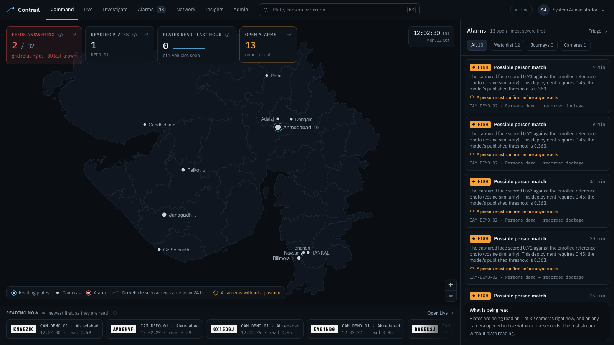 — Command: Gujarat's districts with no map tiles, cameras grouped by town, the alarm dock, plates arriving along the bottom.

**Speaker notes (30 s).** "Gujarat already owns about eighty thousand cameras across
twenty-six departments and many vendors. What it lacks is one place to ask: where has
this vehicle been today? Contrail is that place. It does not replace a single camera
or recorder. It federates them, runs the AI next to the video, and sends the state
only what the cameras saw. What you see behind me is not a mock-up: it is the
platform running on this laptop against the organisers' grid."

**Sources.** Pitch narrative: `docs/review/SENTINEL_JUDGE_REVIEW.md` §8. "~2 KB per
vehicle": event size measured at 1.8–2.4 KB (`docs/HLD.md` §19.1).

---

## Slide 2 — The problem: the cameras exist, one way to use them does not

**On the slide**

- ~80,000 cameras · ~26 departments · many vendors · analog and IP · up to ~1,000 km apart
- Each department: its own VMS, its own login, its own retention
- Following one vehicle across districts today means asking each owner for footage and reviewing it by hand

**Visual:** The brief's constraints as a table (below). For a designed deck: four or five department "islands" (Police, Municipal/Smart City, R&B tolls, GSRTC, Forests), each with its own recorder and a padlock, and no lines between them.

| The brief | |
|---|---|
| **Cameras** | ~80,000, analog and IP, up to ~1,000 km apart |
| **Owners** | ~26 departments, each with its own VMS, login and retention |
| **Must** | Reuse what exists · grow without a redesign · Model 1 compulsory, plus at least one of Models 2, 3, 4 |
| **Live test** | Onboard ~50 cameras · track a vehicle given on the day · watchlist alerts in real time · GIS, interoperability, performance |

**Speaker notes (30 s).** Do not say "there is no integration"; say what it costs:
time, in an investigation, when time is what matters. The brief also fixes the
constraints we design to: reuse existing infrastructure, grow to ~80,000 cameras
without a redesign, and Model 1 (registry + GIS) is compulsory, combined with at
least one of Models 2, 3 or 4.

**Sources.** The brief as summarised in `docs/HLD.md` §1; 26 departments seeded in the
registry (`scripts/seed.py`, `docs/HLD.md` §20).

---

## Slide 3 — Our model: Model 1 + Model 3 + selective Model 2, with edge AI

**On the slide**

- **Model 1** — one registry and GIS: every camera, owner, position, health and gaps
- **Model 3** — federation middleware: an adapter per protocol or vendor; departmental VMS stay authoritative
- **Selective Model 2** — direct RTSP/ONVIF viewing, pulled only while someone watches
- **Edge AI** — ANPR beside the video; only events cross the WAN. **Model 4 rejected** (next slide)

**Visual:** A four-row table (Model · what it means · our position: ✅ built / ✅ built selectively / ✅ built / ❌ rejected), as in `docs/HLD.md` §2.1.

| Model | Our position |
|---|---|
| **1 · Registry + GIS** (compulsory) | ✅ Built — the foundation everything hangs on |
| **2 · Direct viewing + analytics** | ✅ Built, selectively — a stream is pulled only while someone watches |
| **3 · Federation middleware** | ✅ Built — one adapter per protocol or vendor; departmental VMS stay authoritative |
| **4 · Central VMS** | ❌ Rejected — bandwidth, storage and ownership |

**Speaker notes (30 s).** "A pure viewer cannot answer the statewide registry
question. A pure central VMS cannot answer the bandwidth question. So we took the
registry because it is compulsory and because everything hangs off it; federation
because departments keep custody of their video; direct viewing only on demand;
and the analytics at the edge."

**Sources.** `docs/HLD.md` §2.1, §2.3.

---

## Slide 4 — Why not Model 4: move conclusions, not video

**On the slide**

- Into the centre: **320 Gbps** of video vs **43.7 Mbps** of events — **7,324× less** *(arithmetic)*
- Central video storage: **24.2 PB (7 d) / 51.8 PB (15 d)** vs **none** — it stays in departmental recorders
- That disk alone, **₹51.8 crore**, exceeds Contrail's entire capex of **₹39.31 crore** *(arithmetic, assumed unit prices)*
- Inference costs the same wherever it runs; moving video is the difference

**Visual:** Two bars on a log scale — 320 Gbps against 43.7 Mbps — with "7,324×" between them. Underneath, one line each for storage and capex.

| 80,000 cameras | Model 4: centralise video | Contrail: centralise events |
|---|---|---|
| Into the centre | 320 Gbps | **43.7 Mbps** — 7,324× less |
| Central video storage, 7 / 15 days | 24.2 / 51.8 PB | **None** — stays with departments |
| Decode at the centre | 10,000–14,000 cores | **None** — done at the edge |
| Capex (CPU; 7 / 15-day video) | ₹63.50 / ₹91.15 crore | **₹39.31 crore** |

**Speaker notes (40 s).** 80,000 cameras at 4 Mbps (1080p15 H.264) is 320 Gbps that a
central VMS has to carry and record. One vehicle event per camera per 30 seconds at
2 KB is 2,667 events a second: 43.7 Mbps for the whole state. A central VMS would
also decode every stream at the centre — 10,000 to 14,000 cores before any
inference. "We do the same decode at the edge, where the video already is. The
decode moves; it does not disappear." Every figure is printed by one script with
its inputs: `python3 scripts/capacity_model.py --cameras 80000 --provenance`.

**Sources.** `scripts/capacity_model.py --cameras 80000` (run 12 Oct); `docs/HLD.md`
§2.2 and §19.2 (storage = 80,000 × 4 Mbps = 3.456 PB/day; ₹10,000/TB assumed).

---

## Slide 5 — Architecture: adapters → edge workers → one event bus → one registry

**On the slide**

- Adapters: RTSP · ONVIF · vendor VMS API · the organisers' hosted grid · simulated VMS
- Edge worker: vehicle detection → tracking → plate detection → OCR → multi-frame consensus → ~2 KB event
- Centre: events consumed exactly once → watchlist match → alarms on every screen; routes, anomalies, traffic, audit
- Video only on demand: MediaMTX (WebRTC/HLS), or our authenticated proxy for the grid

**Visual:** 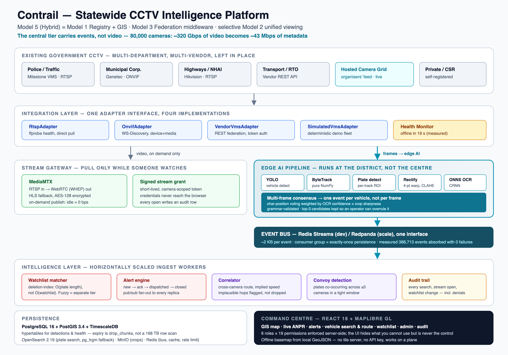

**Speaker notes (40 s).** Walk the picture left to right. "Adding a vendor is one
adapter class and one registry entry." The worker models are YOLOv8n for vehicles,
ByteTrack, YOLO11n for plates and PP-OCRv4 through RapidOCR, all ONNX on CPU, no
PyTorch in the shipped image. Events go on a Redis Stream with a consumer group;
the bus sits behind an interface so Redpanda/Kafka can replace it at state scale —
**that driver is not written yet**, say so if asked. PostgreSQL with PostGIS and
TimescaleDB holds the registry and the detections; MinIO holds plate crops in a
private bucket.

**Sources.** `docs/HLD.md` §3–§5; `docs/review/SENTINEL_JUDGE_REVIEW.md` §1.2 (the
architecture as found in code); bus seam `event_bus_backend`, `docs/HLD.md` §13.

---

## Slide 6 — Live test 1–2: onboard the cameras, integrate the feeds

**On the slide**

- The organisers' **30 grid cameras** onboarded from their catalogue by `HostedGridAdapter` — Model 3 federation
- Heterogeneous, measured: 24 × H.264 and 6 × HEVC, 960×576 to 2560×1440; grid credentials never reach the browser
- Bulk CSV with a dry run: each rejected row comes back *with its reason*; manual form; API client role
- One registry: department, integration, transport, position, health

**Visual:** 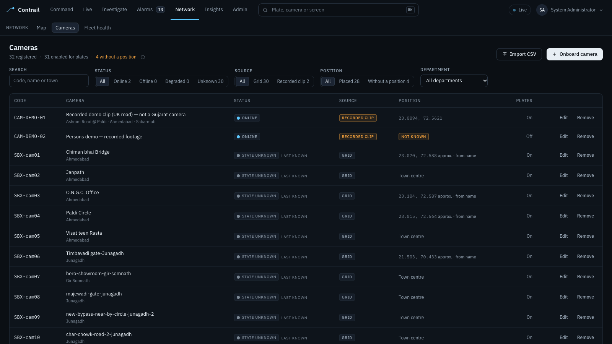 — Network → Cameras: source (grid / recorded clip), status, position, department filters, Import CSV and Onboard camera.

**Speaker notes (35 s).** Show **Import CSV → Validate only** with
`data/seed/sample_cameras.csv`: three would be created, one is refused because its
coordinates are in London. The brief asks for about fifty cameras from several
departments; **we have the organisers' thirty plus our own recorded feeds — say the
number on screen, do not round up.** Most grid cameras arrive with no owner; the
registry says "unassigned" rather than guess. Grid reality: one session per address
and a watch-time quota, so the workers back off and the Live screen never opens a
video wall of grid cameras.

**Sources.** `docs/DEMO_SCRIPT.md` §2.2; `services/api/app/adapters/sandbox.py`;
`docs/BUILD_STATE.md` "The grid refuses churn" (11 Oct).

---

## Slide 7 — Live test 3: track a vehicle

**On the slide**

- ⌘K a plate → every sighting: time (IST), camera, place, read confidence, plate crop — and the route on the map
- Legs that fail plausibility are **flagged, never dropped**; distances and speeds are labelled lower bounds
- "Possibly the same vehicle": reads one or two characters away, each with its reasons; an analyst includes or dismisses, audited
- Pursue predicts the cameras it can reach next — shown here, not started

**Visual:** 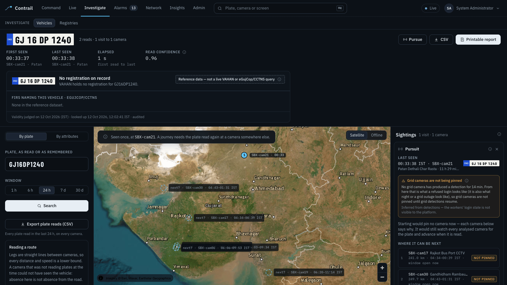 — a Gujarat plate read on the organisers' grid (SBX-cam21, Patan), the reference registry card, and the pursuit prediction listing the cameras it could reach next with their distance and time window.

**Speaker notes (45 s).** Type the plate given on the day. If it was read: the
journey, **Replay journey** in proportion to real time, **CSV** and **Printable
report**. If not: "close to what you typed", candidates that count the classic
misreads (0/O, 1/I, 8/B, 5/S) as half a difference, and the honest sentence —
"we did not read it in this window; that is not evidence the vehicle was absent".
Pursuit uses straight-line distance and a speed band (observed, or a stated
10–60 km/h default); **Start** would keep up to two predicted cameras analysed for
15 minutes. **Known gap:** on 12 Oct no plate had yet been read at two different
grid cameras, so there is no live multi-camera journey on record; the engine is
built and tested, the evidence is what the day must supply.

**Sources.** `docs/DEMO_SCRIPT.md` §2.3; `services/api/app/services/correlator.py`,
`candidates.py`, `pursuit.py`; journey gap: `docs/HLD.md` §22.2, `OUTPUT_REPORT.md`.

---

## Slide 8 — Live test 4: alerts and history

**On the slide**

- Watch a plate → the next settled read on **any** analysed camera raises the alarm by itself — nothing injected
- Exact match at the entry's own priority; a one-character near match is capped at medium and labelled
- Alarm detail: crop, camera, time, confidence, **why it fired**, **what to do**, the case; keyboard triage, every transition recorded
- Detection → alarm on a connected screen: **24 ms** *(measured)*

**Visual:** 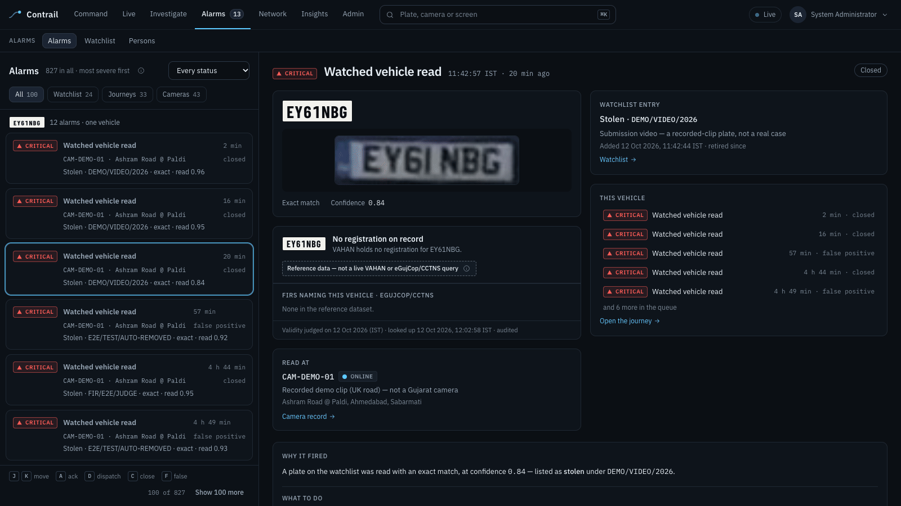 — a critical "Watched vehicle read" on CAM-DEMO-01 with its crop, the watchlist entry and its case reference, and Why it fired.

**Speaker notes (40 s).** Do it live on **CAM-DEMO-01**: add a plate the clip is
reading, category Stolen, priority Critical, a `DEMO/…` case reference. In three
recorded walk-throughs on 12 Oct the alarm arrived **2, 5 and 11 seconds** after the
plate was watched — that is when the car came round in the 15-second loop, not
pipeline latency; the 24 ms is detection-to-screen. Triage with `j/k`, `a` acknowledge, `d` dispatch,
`c` close, `f` false positive. Then close it and retire the entry: never leave a
demonstration entry live.

**Sources.** `docs/HLD.md` §7.1, §8, §19.6 (24 ms); the 2–11 s from three runs of
`tests/browser/record_demo.mjs` on 12 Oct; `docs/DEMO_SCRIPT.md` §2.4.

---

## Slide 9 — Live test 5–6: the map, route history and searchable events

**On the slide**

- GIS: cameras clustered by place, filters by department / status / integration; satellite when online, **offline basemap** with no network at all
- Cameras without a known position are listed apart, never dropped on the map at a guess
- Export plate reads (CSV): every plate read in a window, on every camera, with timestamps — the submission's detected-plates report
- Fleet health and a downloadable gap report: where the network is blind, and why

**Visual:** 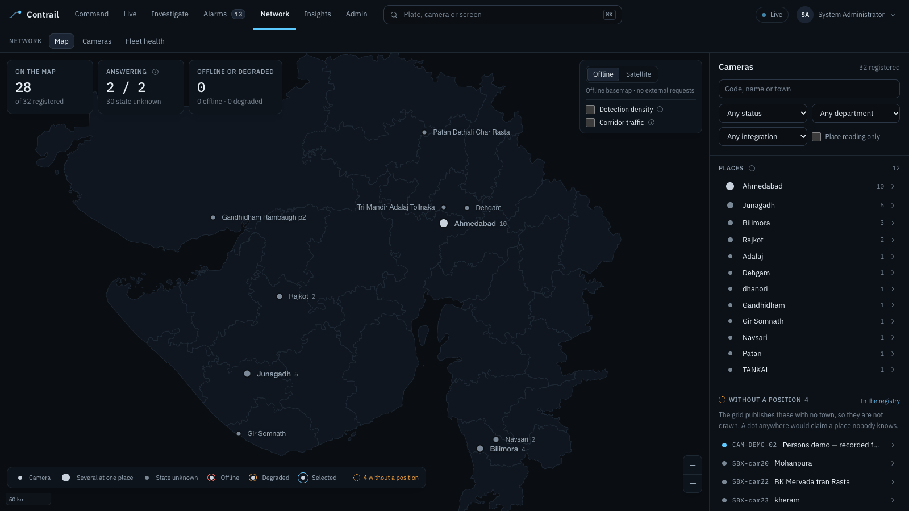 — Network → Map with the place list, the "without a position" panel and the offline basemap toggle.

**Speaker notes (30 s).** The district outlines are committed GeoJSON, so the map
works on a plane or on hostile venue Wi-Fi. The grid's catalogue names places,
not coordinates, so grid cameras are placed at town level and labelled so; a
camera whose place we could not find stays off the map and is listed. The plate
report and every per-vehicle report are themselves plate searches, so they land
in the audit trail.

**Sources.** `docs/DEMO_SCRIPT.md` §2.5–§2.6; `GET /api/v1/reports/plates.csv`,
`/reports/gaps.csv`.

---

## Slide 10 — ANPR, measured rather than claimed

**On the slide**

- Recogniser on legible grid crops: **61.7% → 83.3%** exact after feeding it the raw crop (p = 0.001) *(measured, AI-labelled)*
- Committed (grammar-valid) reads that were right: **92%**; capture → event p50 **330 → 241 ms**; single-read plates **24% → 9%**
- Night yield on the grid: cars 11.3%, trucks 19.7%, two-wheelers 0% — junction overviews are not ANPR cameras
- **We claim no system accuracy.** >90% needs a two-person, human-labelled set of ~400 vehicles scoring ≥93%

**Visual:** 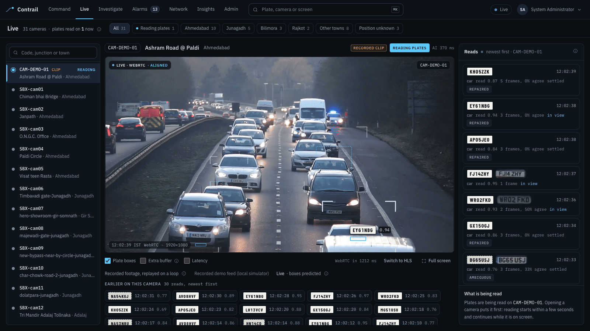 — Live on CAM-DEMO-01: vehicles boxed, plates read with confidence and consensus, the "Recorded clip" label.

**Speaker notes (45 s).** "Judges who probe accuracy should find that we already know
our numbers." Two evaluations on 12 Oct, both night-time grid crops labelled by AI
labellers, biased towards partly readable plates: research set 37/60 → 50/60; the
rebuilt gold set 42/54 → 47/54. They rank configurations; they do not certify a
system. The same work halved H.264 decode per open stream (0.140 → 0.070 cores).
The camera on screen is a recorded clip of a UK road — British plates — say so.

**Sources.** `docs/HLD.md` §15.3; `docs/research/ANPR_ACCURACY_LATENCY.md`;
`docs/BUILD_STATE.md` "ANPR accuracy and latency, measured" (12 Oct); `ai-lab/FINDINGS.md` §9.

---

## Slide 11 — Persons watchlist, behind four eyes

**On the slide**

- Enrolled by one account, approved by **another** — refused by the API *and* by database constraints
- Purpose, case and expiry required (30 days by default, never more than 90)
- A match is "possible", shown face beside face with similarity against threshold — **a person must confirm it before anyone acts**
- Faces that match nothing are never stored, not even as numbers; every view of a photo is audited

**Visual:** 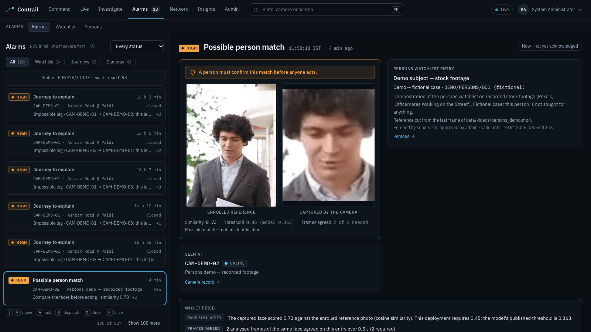 — the enrolled reference and the captured face side by side, similarity 0.71 against threshold 0.45, frames agreed, and the confirmation notice.

**Speaker notes (40 s).** The brief asks for watchlists of wanted or missing persons
alongside vehicles. Faces run only on cameras explicitly tagged for it, never on the
grid's junction cameras where a face is a few pixels. Models are YuNet and SFace,
MIT and Apache-2.0. On the demo clip — three people, stock footage, a fictional case —
the same person scored 0.58–0.96 and anyone else −0.04–0.29; the 0.45 threshold sits
in that gap. **Three people is not a validation set**; no claim is made for real CCTV
faces. Never call an entry "wanted" in the demo.

**Sources.** `docs/SECURITY.md` §7.1; `docs/BUILD_STATE.md` "The persons watchlist"
(12 Oct); `docs/HLD.md` §7.2.

---

## Slide 12 — Registries: VAHAN · SARTHI · eGujCop/CCTNS · AFIS — ready, and labelled

**On the slide**

- Real adapters behind one interface; today they answer from a **labelled local reference dataset**
- Every answer is stamped `source: reference` by the adapter class itself — nothing downstream can relabel it live
- Checks against what was seen: FIR-linked, insurance expired, PUC expiring, colour or class mismatch — each with its reason
- Every lookup audited; a live connector is one class and one line

**Visual:** 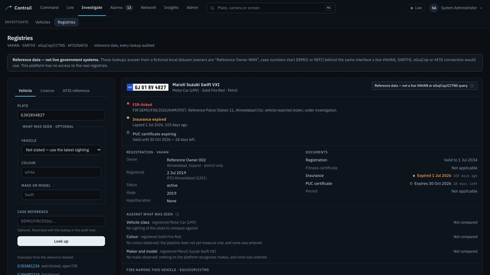 — a reference VAHAN record that is FIR-linked with insurance expired and PUC expiring, under the banner "Reference data — not live government systems".

**Speaker notes (30 s).** "We do not have access to VAHAN, SARTHI, eGujCop or AFIS,
and we will not pretend to." The reference set is fictional and generated
deterministically: 330 registrations, 146 licences, 20 FIRs, 9 AFIS records, owners
named "Reference Owner NNN", every plate at least three characters away from any
plate the cameras have read. AFIS records have no field that could hold biometric
data. Live integration needs NIC/SCRB access and an MoU; the interface is the
deliverable.

**Sources.** `docs/BUILD_STATE.md` "External registries" (12 Oct);
`services/api/app/adapters/registries/`; `docs/HLD.md` §22.4.

---

## Slide 13 — Traffic insights and journeys to explain

**On the slide**

- Vehicle counts, flow by corridor, congestion with its **factors**, a short forecast; gaps drawn as gaps, never filled
- Trajectory anomalies — rare transition, too slow, too fast, impossible hop — each alarm carries its **reasons**
- Called a **journey to explain**: movement that differs from the norm, for a person to judge
- Recorded clips are left out of anomaly verdicts and, by default, out of the counts

**Visual:** 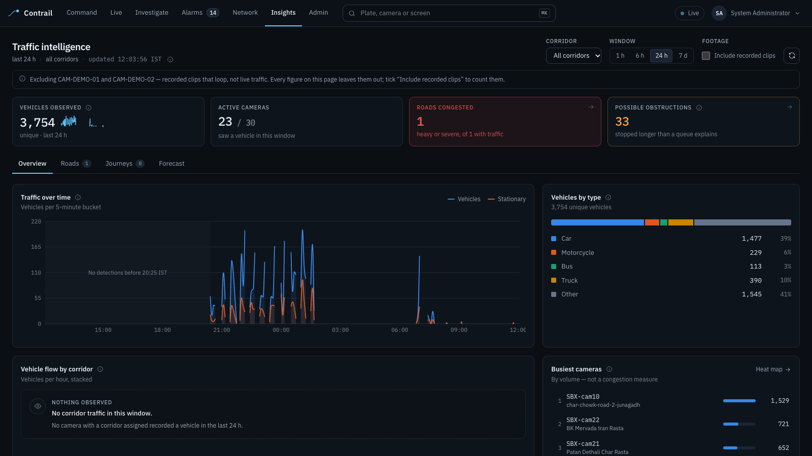 — Insights: vehicles observed, active cameras, roads congested, possible obstructions, and traffic over time with its gaps drawn as gaps.

**Speaker notes (30 s).** Every figure says what it was computed from and what it
left out. Recorded clips are excluded from Insights by default and the screen names
them; a toggle puts them back. Until 12 Oct the looping clip on CAM-DEMO-01 supplied
about 93% of the "vehicles observed" and rated its own road "severe" — that is why
the exclusion exists, and a judge who saw the earlier screen may ask. What remains
is what the organisers' grid and any live camera saw. Crowd counting is not built.

**Sources.** `services/api/app/services/traffic.py`, `anomaly.py`,
`recorded_footage.py`; `routers/analytics.py` (`include_recorded`); `docs/HLD.md` §9,
§22.1; the 93% from `docs/review/SENTINEL_JUDGE_REVIEW.md` §2.4 (49,034 of 52,787 in 24 h).

---

## Slide 14 — Security and audit: who looked at what

**On the slide**

- Six roles × 23 permissions in one server-side matrix; **an auditor cannot run a vehicle search**
- Every plate search, stream open, watchlist change, persons action and registry lookup writes an audit row — **reading the audit is itself audited**
- argon2id, 15-minute JWT with rotating refresh and a denylist; camera-scoped stream tokens; plate crops private behind short-lived signed links; HTTPS on the web tier
- **Not yet:** network segmentation, stream auth on our own gateway, per-person demo accounts, encryption at rest

**Visual:** 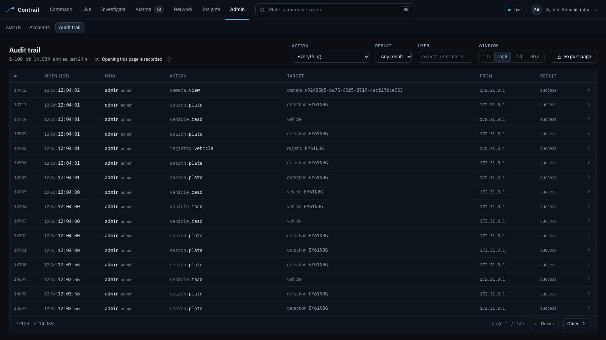 — Admin → Audit trail: who, role, action, target, source address, result, including denied attempts.

**Speaker notes (40 s).** This platform tracks where private vehicles go, so
traceability is a feature, not paperwork: the prototype held **12,374 audit rows** at
the 11:23 IST backup on 12 Oct. Name the open items before a judge finds them: on
this laptop Postgres, Redis (no password), MinIO and MediaMTX are published on every
interface; our own simulator streams are not checked against the stream token; the
demo roles share one password; the audit log is not yet tamper-evident; the
detector weights are AGPL-3.0. Each has its production fix in HLD §16.7.

**Sources.** `docs/SECURITY.md` §1–§3, §7.1; `docs/HLD.md` §16.1, §16.7, §19.6;
`b4df4d1` (private crop bucket).

---

## Slide 15 — Scalability: what is measured, what is arithmetic

**On the slide**

- **Measured:** central ingest **2,774 events/s** for 80,000 camera identities, **0 failed** — p95 **5.7 s missed the 3 s target** (queue wait under backlog)
- **Measured:** 4 always-on cameras + the one on screen run on **4.4–5.6 cores** of this laptop
- **Arithmetic:** 0.46 core per camera → **911 × 40-core nodes** at **33 edge sites**; storage hot 3.3 TB · warm 361 TB · cold 861 TB
- **Extrapolated:** GPU 91–228 nodes — needs hardware decode, not built; ANPR on a 20% subset: 182 nodes

**Visual:** The table below, each figure with its kind. Optional inset: Fleet health (`screens/11-fleet-health.png`).

| Kind | Figure |
|---|---|
| **Measured** | 2,774 events/s for 80,000 identities, 0 failed · p95 5.7 s against a 3 s target |
| **Measured** | Capture → browser p50 135 ms · 4 always-on + 1 on screen = 4.4–5.6 cores |
| **Arithmetic** | 0.46 core per camera → 36,446 cores = 911 nodes at 33 edge sites |
| **Arithmetic** | Hot 3.3 TB (7 d) · warm 361 TB (90 d) · cold 861 TB (5 y) |
| **Extrapolated** | GPU at 4× / 10×: 228 / 91 nodes, ₹19.94 / ₹9.69 crore — needs hardware decode |

**Speaker notes (45 s).** The load test ran 80,000 camera identities through three
consumer replicas on one laptop: 388,713 rows written, 397 alerts raised, nothing
failed — and it **missed its latency target**: the backlog grew to 10,237 and cleared
after the generator stopped. Fix: more consumer replicas or batching; it is a
rollout gate. The per-camera cost comes from Apple Silicon in Docker; the first
rollout gate re-measures it on the real x86 node. "Not every camera needs ANPR —
most of the estate is overview CCTV; plate reading belongs on ANPR-grade junction
and highway cameras."

**Sources.** `tests/load/results/load-20260905T064430.json`; `docs/HLD.md` §15;
`python3 scripts/capacity_model.py --cameras 80000` / `--gpu-speedup 4,10` /
`--cameras 16000`; `docs/INFRASTRUCTURE.md` §3–§6.

---

## Slide 16 — Cost-benefit: the difference is moving and storing video

**On the slide**

- Capex: **₹39.31 crore** (Contrail) vs **₹63.50 / ₹91.15 crore** (Model 4, 7 / 15-day video)
- Opex per year: **₹8.78 crore** vs **₹56.28 crore** — WAN alone ₹0.50 vs ₹48.00 crore
- Five years: **₹83 crore** vs **₹345–373 crore** — and Model 4's column is a floor
- Departments keep their cameras, recorders, licences and custody of their video

**Visual:** One grouped bar chart: capex, opex/yr and 5-year cost for Contrail, Model 4 (7 d), Model 4 (15 d). Footnote: "Arithmetic from assumed unit prices; indicative, excluding GST, not quotes."

| ₹ crore · arithmetic, assumed prices | Contrail | Model 4 · 7 d | Model 4 · 15 d |
|---|---|---|---|
| Capex | **39.31** | 63.50 | 91.15 |
| Opex per year | **8.78** | 56.28 | 56.28 |
| — of which WAN per year | **0.50** | 48.00 | 48.00 |
| 5 years (capex + 5 × opex) | **83.19** | 344.90 | 372.55 |

**Speaker notes (40 s).** Both columns use the same unit prices and the same
analytics pipeline, so the gap is the architecture alone. The conclusion survives
every sensitivity we tried: WAN at a tenth of the price still leaves Model 4
1.5–1.9× dearer over five years; ANPR on only 20% of cameras widens the gap,
because a central VMS still records every camera. Benefits we state as measured
properties, not rupees: an alarm on screen in 24 ms, a dead camera noticed in 19 s,
custody unchanged. "We have no basis to convert investigator hours into money, so
we do not."

**Sources.** `docs/HLD.md` §19.2–§19.6; `scripts/capacity_model.py`.

---

## Slide 17 — Rollout: each stage starts when the last one's gates have printed

**On the slide**

- **0 · Sandbox (now):** grid federated, watchlist alarm in 24 ms, 2,774 events/s — p95 gate missed
- **1 · One district:** re-profile on x86, ≥400-vehicle human-labelled accuracy set, 1-hour WAN pull with zero events lost, p95 < 3 s, TLS and encrypted volumes
- **2 · One range:** timed failover drill (RPO 15 min / RTO 1 h), Redpanda bus, regional crop stores, one GPU node measured
- **3 · The state:** 33 sites, 5,334 events/s at p95 < 3 s, penetration test, DPIA, live registries under MoU

**Visual:** A left-to-right timeline of four stages; under each, its gates as ticks (✅ passed, ❌ missed, ○ not yet run). Days 0–30 / 30–90 / 90–180 / 180+ beneath.

| Stage | Scope | Gates |
|---|---|---|
| **0 · Sandbox** (now) | One laptop, the organisers' grid | ✅ federation · ✅ 24 ms alarm · ✅ 2,774 events/s · ❌ p95 < 3 s |
| **1 · District** (days 30–90) | One x86 edge site | x86 re-profile · 400-vehicle labelled set · 1 h WAN pull, 0 lost · TLS + encryption |
| **2 · Range** (days 90–180) | Several districts | Failover drill (RPO 15 min / RTO 1 h) · Redpanda · regional crops · one GPU node measured |
| **3 · State** (180+) | 33 sites, 26 departments | 5,334 events/s at p95 < 3 s · pen test · AGPL weights · DPIA · live registries under MoU |

**Speaker notes (35 s).** "A gate that has not been run is a gate that has not
passed." The first 30 days need no hardware: close the security items, department-
scoped access (police statewide; mobility operators their own cameras and
aggregates; facility owners their own cameras only), registry completeness and
gap analysis on Gujarat's 33 districts. Sites are independent, workers re-shard by
hash and the event tier adds consumer replicas — what changes on the way is
deployment (Redpanda, a replicated Postgres, regional object stores), not the
architecture.

**Sources.** `docs/HLD.md` §17, §20.1, §21, §22.

---

## Slide 18 — Honest limits, and why this is still the right design

**On the slide**

- Not on record yet: a live multi-camera journey on the grid; any system accuracy figure; the WAN-pull and failover drills
- Not built: Kafka/Redpanda driver, HA and DR, network segmentation, department-scoped access, crowd counting, live registry connectors
- Our own feed is a recorded clip; registries are reference data; faces are validated on three people
- What is built federates, alarms, explains and audits — on one laptop, against your grid, today

**Visual:** No screenshot. Two columns, "Built and measured" and "Designed, gated", ending with the line: *Federate what departments already run · AI at the edge · events, not video, to the centre.*

| Built, and running today | Designed and gated, or not yet on record |
|---|---|
| Federation of the organisers' grid; registry and GIS | A live multi-camera journey on the grid |
| Edge ANPR, watchlist alarms, persons four-eyes, audit | A system accuracy figure (needs a human-labelled set) |
| 2,774 events/s ingest at 80,000 identities, 0 failed | p95 < 3 s; Redpanda; HA and DR; segmentation |
| Registry interfaces, answering from reference data | Live VAHAN / SARTHI / eGujCop / AFIS (needs an MoU) |

**Speaker notes (30 s).** "Being the team that says it first is worth more than
hoping nobody asks." Then close: "Contrail grows district by district on commodity
hardware without a redesign, because the expensive thing — moving and storing
video — is the thing it never does. Thank you." Hand over to the live test.

**Sources.** `docs/HLD.md` §18, §15.3, §22; `docs/DEMO_SCRIPT.md` §5;
`docs/submission/OUTPUT_REPORT.md`.

---

## Appendix — screens in this folder

| File | Screen | Used on |
|---|---|---|
| `screens/01-command.png` | Command (`/dashboard`) | 1 |
| `screens/02-live.png` | Live on CAM-DEMO-01 (`/anpr?camera=CAM-DEMO-01`) | 10 |
| `screens/03-investigate-grid.png` | Investigate a grid plate with the pursuit prediction (`/vehicles?plate=…&pursuit=1`) | 7 |
| `screens/04-investigate-candidates.png` | Investigate a grid plate with a "possibly the same vehicle" candidate | spare for 7 |
| `screens/05-alarm-watchlist.png` | A watchlist alarm's detail (`/alerts?alert=…`) | 8 |
| `screens/06-alarm-person.png` | A possible person match with the confirmation notice | 11 |
| `screens/07-persons.png` | Persons watchlist: four-eyes queue and matched entries | spare for 11 |
| `screens/08-registries.png` | Registries: a reference VAHAN record (`/registries?plate=GJ01RV4827`) | 12 |
| `screens/09-map.png` | Network → Map | 9 |
| `screens/10-cameras.png` | Network → Cameras (the registry) | 6 |
| `screens/11-fleet-health.png` | Network → Fleet health and the gap report | 15 |
| `screens/12-insights.png` | Insights (`/traffic`) | 13 |
| `screens/13-audit.png` | Admin → Audit trail | 14 |
| `screens/14-watchlist.png` | Alarms → Watchlist with the fictional `DEMO/…` entries | spare for 8 |

Re-capture any of them from the running stack (never on an `SBX-*` camera):
`cd tests/browser && node shot.mjs --size 1600x900 --wait 8000 --out out/deck dashboard "anpr?camera=CAM-DEMO-01" …`
